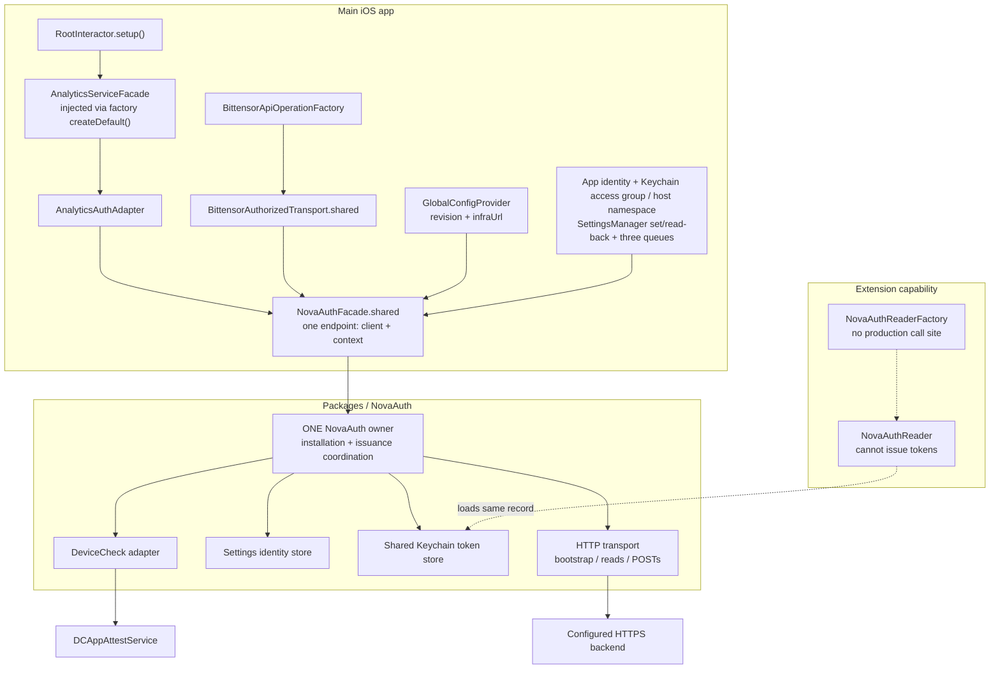
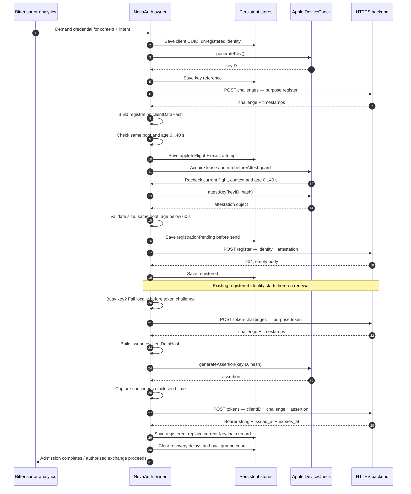
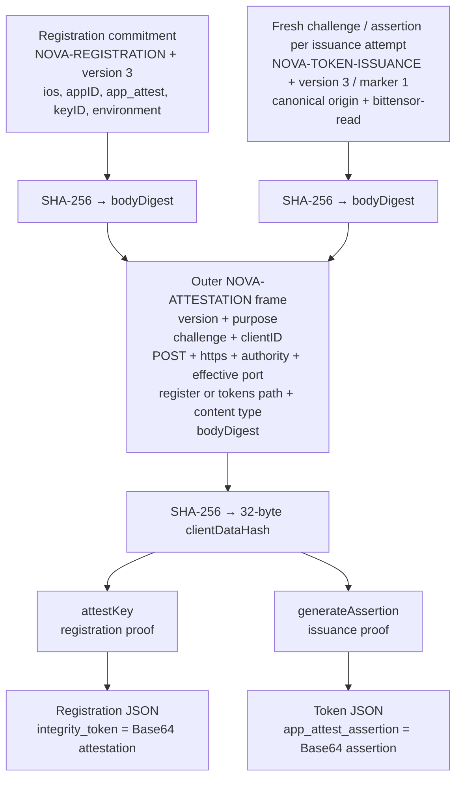
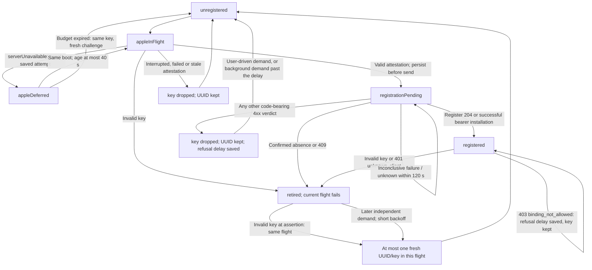
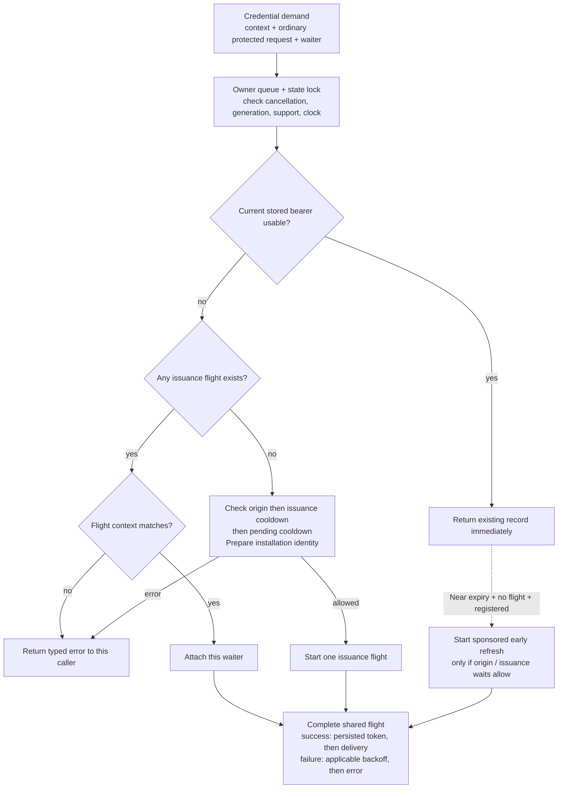
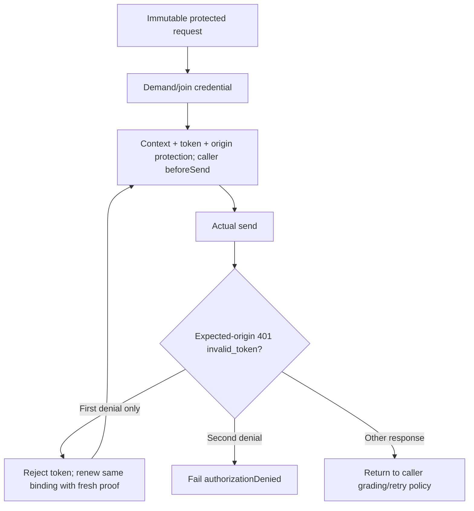
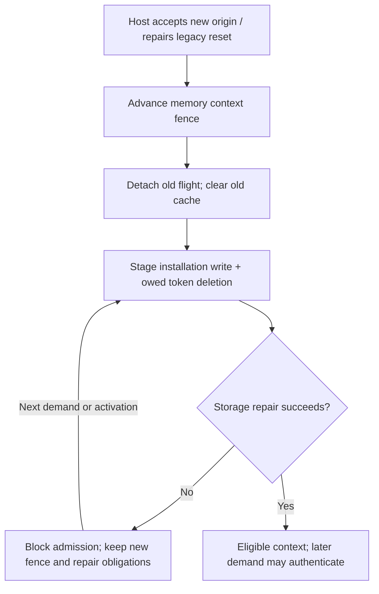
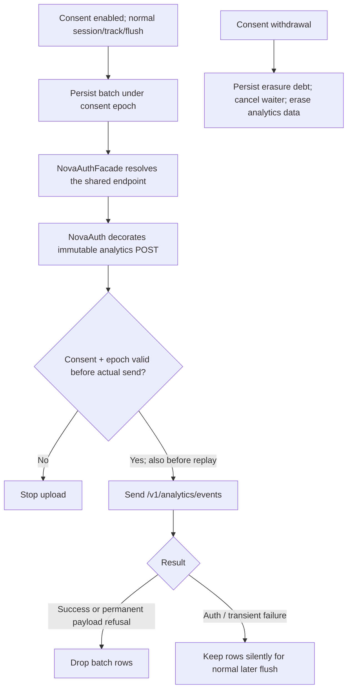
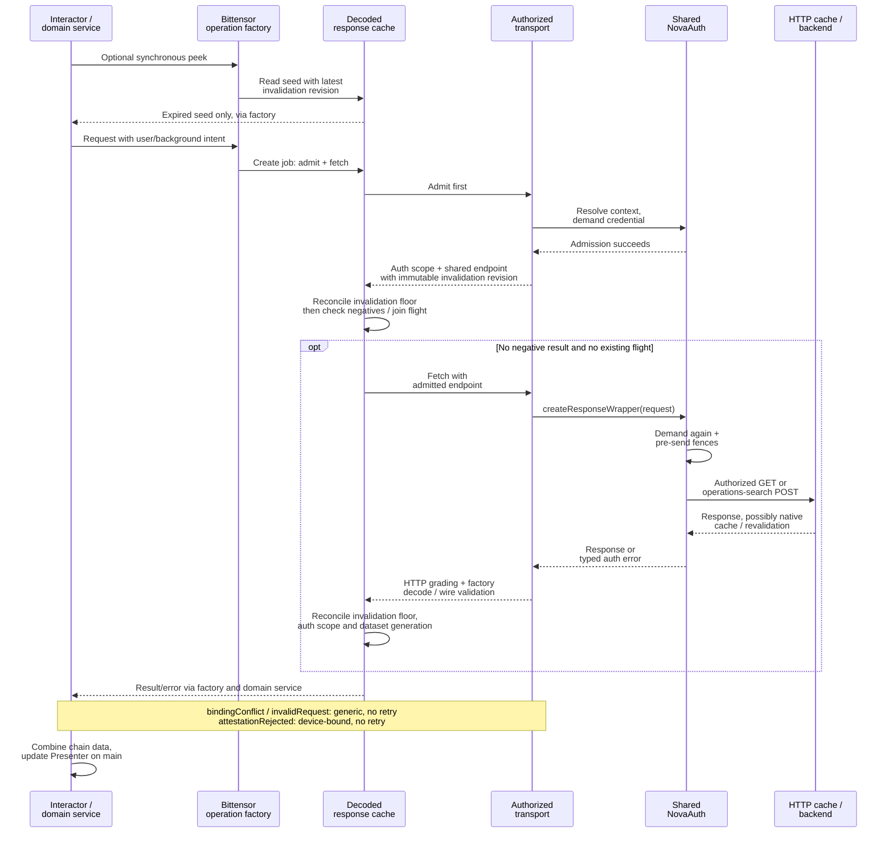
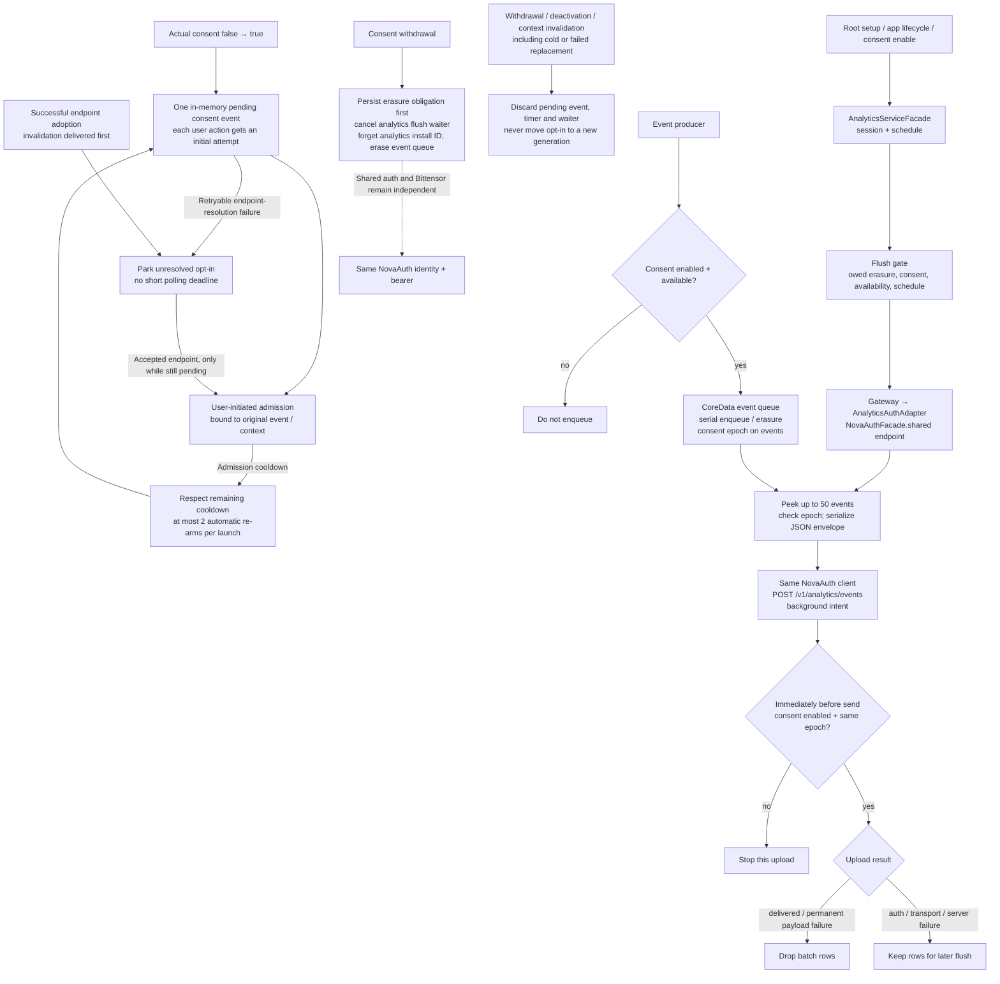

# NovaAuth — client architecture

These diagrams describe the Swift client. “Backend” is only the HTTPS peer that the client calls; its internal behavior and deployed permissions are outside this document.

**Reading order:** ownership → first authentication → proof construction → registration recovery → token reuse/concurrency → protected requests → storage/replacement → analytics.

**Reading order:** ownership → first authentication → proof construction → registration recovery → token reuse/concurrency → protected requests → storage/reset → Bittensor → analytics.
The central invariant is **one main-app NovaAuth owner, one installation identity, and one current persisted bearer for the active backend context**. Bittensor and analytics receive the same client. Requests already in flight can still hold the preceding valid bearer during refresh. Wallet accounts do not supply authentication keys.

## 1. Ownership and app composition

The facade is the app’s composition boundary. It creates the package owner once, resolves the current backend, and exposes an endpoint containing **the shared client + `(origin, generation)` context**. Activation establishes context; the first credential demand starts authentication.

- Root starts analytics before wallet setup. There is no `ServiceCoordinator → NovaAuth.setup` path; authentication is driven by consumer requests.
- The facade rejects unsupported App Attest, missing app identity, and real-client creation under `-UNITTEST`.
- Auth stores the bearer in the app's default Keychain access group; it requires no App Group container, shared access group or Info.plist namespace. Other host features still use the App Group container.
- Settings writes use the injected manager and verify cached read-back. The production manager calls synchronize internally, but neither operation proves durability or detects every refused disk write.
- `infraUrl` may have an empty path or a single root `/`; the facade converts it into a strict HTTPS origin. Credentials, query, fragment and non-root paths are rejected. The accepted endpoint is memoised for the process.
- `appID` is App Identifier Prefix + bundle ID. `F_DEV` selects the development App Attest environment; other builds select production. This is distinct from wallet identity.
- Package code depends on Operation-iOS, NovaOperationSupport, Keystore-iOS and SDKLogger, with Apple platform adapters. It does not depend on app types.

Sources: [facade and composition](../../../novawallet/Common/Network/Auth/NovaAuthFacade.swift) · [configuration conversion](../../../novawallet/Common/Network/Auth/NovaAuthFacade.swift) · [Root startup](../../../novawallet/Modules/Root/RootInteractor.swift) · [app identity](../../../novawallet/Common/Configs/ApplicationConfig+NovaAuth.swift) · [owner construction](../../../Packages/NovaAuth/Sources/NovaAuth/Lifecycle/NovaAuth.swift) · [package dependencies](../../../Packages/NovaAuth/Package.swift) · [settings storage](../../../Packages/NovaAuth/Sources/NovaAuth/API/NovaAuthConfiguration.swift)

## 2. First authentication and subsequent issuance

This is the successful path for a new installation. All four backend calls are POSTs under `/v1/attestation/profile-3/`, with no bearer attached. Registration and token issuance are separate phases in the same coordinated flight.

The caller never gets a newly issued bearer before the Keychain write succeeds. The package treats the bearer as an opaque validated string; it does not decode claims. Challenge responses must describe a 60-second lifetime. Bearer responses must describe a lifetime of 60–900 seconds.

Apple attestation/assertion wrappers have a bounded timeout of up to 100 seconds. Once a native call begins, timeout/cancellation does not release its per-key lease: only Apple's actual callback does. A different key can proceed independently. Issuance checks `isBusy(keyID:)` before creating a token challenge, avoiding network traffic while the key is leased. The registration HTTP request allows 100 seconds; the other HTTP requests allow 20 seconds.

Registration age starts before the challenge request. The early check requires the same boot and `0 <= age <= 40`, choosing a minimum 20-second margin on the 60-second challenge. Exactly 40 seconds passes; at 40.001 a deferred attempt keeps its key and takes a fresh challenge in the same flight, while a fresh attempt falls back to unregistered with the same key and fails the current operation. After Apple's result, same boot and `0 <= age < 60` remain authoritative: the 100-second local timeout means the margin cannot guarantee completion in time.

The early check runs before saving `appleInFlight` and building the wrapper. After acquiring the proof lease, the adapter invokes `beforeAttest` immediately before native `attestKey`; under the owner gate, this guard rechecks the current flight, context and the same inclusive 40-second budget. Queue delay therefore cannot use an earlier successful check to start an expired native attempt. Guard failure releases the **unused** lease without invoking Apple. The fenced completion drops the key of an age-expired current attempt once, keeping the client UUID; a detached/stale flight cannot mutate a replacement context. After invocation the lease is **called** and only Apple's callback releases it, never a local timer.

Sources: [registration service](../../../Packages/NovaAuth/Sources/NovaAuth/Lifecycle/NovaAuthRegistrationService.swift) · [issuance and persistent installation](../../../Packages/NovaAuth/Sources/NovaAuth/Lifecycle/NovaAuthTokenProvider.swift) · [bootstrap endpoints](../../../Packages/NovaAuth/Sources/NovaAuth/HTTP/NovaAuthBootstrapOperationFactory.swift) · [response validation](../../../Packages/NovaAuth/Sources/NovaAuth/Wire/NovaAuthWire.swift) · [Apple adapter](../../../Packages/NovaAuth/Sources/NovaAuth/AppAttest/NovaAuthDeviceCheckService.swift) · [early and post-Apple age checks](../../../Packages/NovaAuth/Sources/NovaAuth/Lifecycle/NovaAuthRegistrationService.swift) · [bearer installation](../../../Packages/NovaAuth/Sources/NovaAuth/Lifecycle/NovaAuthTokenProvider.swift) · [native execution guard](../../../Packages/NovaAuth/Sources/NovaAuth/Lifecycle/NovaAuthRegistrationService.swift) · [unused lease release and native invocation](../../../Packages/NovaAuth/Sources/NovaAuth/AppAttest/NovaAuthDeviceCheckService.swift)

## 3. What the App Attest proof binds

Registration and issuance use different semantic commitments. Each commitment is hashed and included in an outer frame that binds the challenge to the exact bootstrap request. Ordinary Bittensor and analytics requests carry the bearer; they do not get an App Attest assertion for each business payload.

- Text fields are ASCII with a 32-bit big-endian length prefix; domains have explicit NUL/version bytes. The semantic commitment is not a hash of the final JSON body containing the proof.
- `clientID` is a random installation UUID. `keyID` identifies the DeviceCheck-managed key. `appID` identifies the signed app. The context’s `generation` is a local invalidation fence; it is not included in these wire commitments.
- Issuance binds the canonical origin and API major 1. The bearer has no flow/scope; ordinary protected reads and POSTs share it. Renewal always obtains a fresh challenge/assertion; no refresh credential exists.
- `invalid_proof` at `/tokens` retains the key and assertion-counter continuity, fails the operation and retains short auth backoff before a later fresh challenge/assertion. An Apple-deferred registration instead retries the exact saved key/hash within the original age window.
- The source literally uses **`bittensor-read`** in issuance framing and token-record validation, even though the same bearer is attached to analytics and operations-search POSTs. This describes the client implementation; it does not establish which routes a deployed server accepts.

Sources: [exact binary framing](../../../Packages/NovaAuth/Sources/NovaAuth/Wire/NovaAuthFraming.swift) · [JSON fields](../../../Packages/NovaAuth/Sources/NovaAuth/Wire/NovaAuthWire.swift) · [identity types](../../../Packages/NovaAuth/Sources/NovaAuth/API/NovaAuthIdentity.swift) · [credential validation](../../../Packages/NovaAuth/Sources/NovaAuth/Lifecycle/NovaAuthTokenValidation.swift) · [fresh proof retry classification](../../../Packages/NovaAuth/Sources/NovaAuth/Lifecycle/NovaAuthTokenProvider.swift)

## 4. Persisted registration state and recovery

Retirement fails the current caller operation, except that a key found invalid at assertion time is
replaced by one fresh UUID/key within the same flight; no proof is resent and a flight never generates a
second key. Otherwise a later independently created demand may replace after short backoff. Concurrency joins one
issuance flight. There is no lifetime replacement quota; the only intent privilege is that user-driven
demands re-register at once after a refusal while background demands wait for the persisted
1 h / 6 h / 24 h delay, which resets on an app version or context change.

Pending probes preserve UUID/key/start and reserve persisted backoff before sending. A same-boot
token-challenge/issuance `401 unknown_client` before 120 seconds keeps pending state and fails. Outside that window or after
boot discontinuity, conclusive absence retires and fails. Transport/503 alone never prove absence.
There is no unknown-response counter. An intermediate token challenge preserves pending state and its
original window until successful bearer installation. A registered binding receiving conclusive
`401 unknown_client` at either token challenge or issuance retires and fails this flight.

A token-time `403 binding_not_allowed` additionally saves the refusal delay: background demands
wait for it while user-driven demands retry at once. Token `401 invalid_proof` and token challenge/issuance `403 binding_not_allowed` preserve the same
registered UUID/key/counter. Later operations obtain a fresh challenge; no proof is reused and no
key rotates to bypass policy. Status and code are considered together: `503 invalid_proof` is
availability failure. Stored retired states wait for later demand replacement and keep the refusal counter; legacy `policyRefused` keeps the client UUID and attests a fresh key.

Host activation, including accepted origin adoption and legacy-reset repair, authorizes demand-driven
bootstrap, including consented Analytics. It creates no key/request by itself. **This local lifecycle
policy replaces the profile-3 protocol's user-driven re-creation wording.**
The package exposes no reset API. Removed optional legacy quota/gate/delay fields are ignored.

Sources: [state](../../../Packages/NovaAuth/Sources/NovaAuth/Contracts/NovaAuthModels.swift) · [registration](../../../Packages/NovaAuth/Sources/NovaAuth/Lifecycle/NovaAuthRegistrationService.swift) · [pending backoff](../../../Packages/NovaAuth/Sources/NovaAuth/Lifecycle/NovaAuthPendingRecovery.swift) · [retirement](../../../Packages/NovaAuth/Sources/NovaAuth/Lifecycle/NovaAuthRecoveryService.swift)

## 5. Token reuse, refresh and concurrency

Every admission consults the shared current record. Consumers wait on the same issuance flight when there is no usable bearer. When the bearer remains usable, a request can proceed immediately while an early refresh runs alongside it.

**Validity:** matching version/context/clientID; no local rejection fingerprint; valid opaque token syntax; same boot; consistent monotonic timestamps; server lifetime 60–900 seconds. The effective deadline is:

`local token-POST send time + (expires_at − issued_at) − 5 seconds`

Early refresh begins on demand when effective remaining time reaches a stored, randomized threshold of approximately **20–26.67% of the original lifetime**. There is no scheduled refresh timer. Main-owner admission returns a valid bearer before origin, issuance, recovery or pending waits; refresh respects its applicable waits. Without a valid bearer, an existing flight is joined before starting a new one. Business sending separately checks shared-origin cooldowns, even when admission already returned a bearer.

Ordinary issuance Retry-After is in memory and restarting the owner loses that delay: this is an accepted limitation. Pending-registration probe cooldown is persisted. Boot discontinuity ends boot-scoped waits; no replacement quota or optional long-delay ladder survives.

| Execution lane | Responsibility |
| --- | --- |
| Feature queues | Compose wrappers and await results without blocking the owner’s work. |
| `nova.auth.owner` · serial | Credential demand, issuance coordination, state transitions and delivery; state also guarded by `NSLock`. |
| `nova.auth.bootstrap` · maximum 4 operations | Independently runnable Apple and bootstrap HTTP child operations. One logical issuance flight is coordinated above this queue. |
| `nova.auth.requests` · default concurrency | Parallel protected business requests. |
| Analytics persistence queue · serial | Event enqueue/trim/count and erasure; upload peek/drop execute on the configured general upload queue. |

Cancelling a consumer removes only its waiter. The last waiter cancels an issuance child only when the flight is **neither sponsored nor irreversible**. Irreversibility begins before Apple attestation or assertion. A cancelled analytics upload therefore does not abort another consumer’s issuance. Origin replacement detaches the old flight immediately; its late callback cannot affect the new context. Platform calls already started cannot be cancelled at the Apple API level; wrappers settle once, but the same key stays reserved until the actual callback. If Apple never calls back, that key remains busy until process restart.

`issue()` fails locally on a busy key before creating the token-challenge wrapper. It does not release a lease on a timer or consume another native attempt while the first call remains active.

Sources: [demand and token loading](../../../Packages/NovaAuth/Sources/NovaAuth/Lifecycle/NovaAuthTokenProvider.swift) · [early refresh and cancellation](../../../Packages/NovaAuth/Sources/NovaAuth/Lifecycle/NovaAuthTokenProvider.swift) · [validity checks](../../../Packages/NovaAuth/Sources/NovaAuth/Lifecycle/NovaAuthTokenValidation.swift) · [queue composition](../../../novawallet/Common/Operation/OperationManagerFacade.swift) · [child scheduling and delivery](../../../Packages/NovaAuth/Sources/NovaAuth/Lifecycle/NovaAuth.swift) · [busy-key short-circuit](../../../Packages/NovaAuth/Sources/NovaAuth/Lifecycle/NovaAuthTokenProvider.swift) · [issuance and pending backoff](../../../Packages/NovaAuth/Sources/NovaAuth/Lifecycle/NovaAuthPendingRecovery.swift)

## 6. Protected requests, HTTP cache and bounded renewal

NovaAuth has no HTTP cache.

Conclusive replay requires the exact expected HTTPS origin, status 401 and exact
`WWW-Authenticate: Bearer error="invalid_token"`; GET/POST also need a valid invalid-token body,
while HEAD has no body. Maximum one bearer replay preserves method/path/query/body bytes.
A credential rejected before an unsent request permits one bounded readmission. Each readmission
preserves the original client binding; retirement fails the original operation. The caller's
consent/cancellation guard runs before every actual send, including replay.

Only 429 (Retry-After or fallback 30 seconds) and explicit `503 attestation_unavailable` apply shared
auth-origin protection. Other business 5xx/transport failures pass to domain handling. Generic
business success does not clear a shared deadline. Short auth backoff is 1/2/4/8/16/30 seconds plus
up to one second of jitter; Retry-After is clamped to 1–905 seconds. Nothing schedules an auth retry.

Sources: [exchange](../../../Packages/NovaAuth/Sources/NovaAuth/Authorization/NovaAuthAuthorizedOperationFactory.swift) · [send fences and protection](../../../Packages/NovaAuth/Sources/NovaAuth/Authorization/NovaAuth+Authorization.swift) · [denial](../../../Packages/NovaAuth/Sources/NovaAuth/Authorization/NovaAuthBearerDenial.swift)

## 7. Persistence and origin replacement

Settings keeps the current installation storage key/version, context, UUID/key/registration, exact
saved attestation attempt, pending start/cooldown and token-removal debt. Removed optional legacy
fields are ignored even when malformed; surviving security fields remain validated. The next
existing write encodes the reduced schema. A saved refusal delay survives relaunch and resets on an app
version or context change.

State adoption happens before I/O. A failed write never rolls back the active memory fence; staged
write and token deletion retry during activation or the next demand and block admission until repaired. Reset/corrupt
repair cannot adopt an old bearer. Settings read-back observes a manager cache and cannot prove
disk durability; no transaction/commit API is implied.

Keychain contains one atomic version-2 bearer with origin/client/generation and boot-bound continuous
deadline. Persistence precedes delivery. Conditional fingerprint deletion cannot erase a newer
record; the sole owner under its gate may remove an untagged legacy record only after reload still
matches. Corrupt token reads do not delete data. The default access group separates signed app variants, and the owner caches the loaded record under its gate.

The session's request/resource timeouts, the 110-second HTTP operation watchdog and the native watchdog remain. Called native leases release only on actual callback, even after
local timeout. The flight's irreversible commitment stays sticky independently of its current step.
Failure-only logs are asynchronous: fixed step/category, numeric status, allowlisted code and
sanitized correlation ID. Tokens, IDs, proofs, bodies and arbitrary Error/state are never logged.

Sources: [owner and repair](../../../Packages/NovaAuth/Sources/NovaAuth/Lifecycle/NovaAuth.swift) · [settings](../../../Packages/NovaAuth/Sources/NovaAuth/Storage/NovaAuthSettingsIdentityStore.swift) · [Keychain](../../../Packages/NovaAuth/Sources/NovaAuth/Storage/NovaAuthKeychainTokenStore.swift) · [redacted failures](../../../Packages/NovaAuth/Sources/NovaAuth/Authorization/NovaAuthDiagnostics.swift)

## 8. Analytics: shared authentication, separate consent and data
| Uncoded 502/503/504, other 5xx, and coded domain 5xx except the explicit shared case | Analytics or Bittensor family only. |
| GET / HEAD | `/v1/bittensor/profile-3/subnets` |
| GET / HEAD | `/v1/bittensor/profile-3/subnets/{netuid}/validators` |
| GET / HEAD | `/v1/bittensor/profile-3/yields/root` |
| GET / HEAD | `/v1/bittensor/profile-3/subnets/{netuid}/yields/alpha` |
| GET / HEAD | `/v1/bittensor/profile-3/recommendations` |
| GET / HEAD | `/v1/bittensor/profile-3/recommendations/subnets` |
| GET / HEAD | `/v1/bittensor/profile-3/recommendations/subnets/{netuid}/validators` |
| POST · JSON | `/v1/bittensor/operations/search` |
`netuid` must be canonical UInt16 text. GET/HEAD are package capabilities; the current Bittensor factory calls GET. Its current factory also does not expose the per-subnet recommendation-validators route. The table shows the package allowlist, not a claim that every route has an active caller.
**Separately owned server migration:** release coordination must confirm that both existing POST paths accept this same profile-3 `bittensor-read` bearer and that `invalid_token` is rejected **before either POST reaches its business handler**. This pre-handler contract permits the single replay of identical bytes. The client predicate cannot establish deployed server ordering. There is no legacy fallback or client backend migration here.

Analytics owns consent, epoch/session, its content install identifier and persistent event queue.
These are separate from NovaAuth's installation UUID, key and bearer. Withdrawal and wallet changes
do not reset authentication. Consent enablement retains normal session start and tracking; there is
no separate admission/re-arm helper. Saved consent may permit ordinary later uploads after host
activation under the explicitly changed lifecycle policy in view 4.

Every upload checks current consent/epoch immediately before send; NovaAuth repeats that guard
before its single authorized replay. Auth failures retain batches silently for the existing later-flush
policy. No auth prompt, dialog or analytics notification is produced. Background flush sends at most
one batch; other flushes at most ten, with fifty-event batches and existing payload rejection rules.

Sources: [facade](../../../Packages/NovaAnalytics/Sources/NovaAnalytics/AnalyticsServiceFacade.swift) · [uploader](../../../Packages/NovaAnalytics/Sources/NovaAnalytics/AnalyticsUploader.swift) · [upload operation](../../../Packages/NovaAnalytics/Sources/NovaAnalytics/Network/AnalyticsUploadOperationFactory.swift)
5. Facade reset always notifies context observers, including on failure. Adoption compares the package invalidation ID around activation and also notifies on a failed replacement/repair if the memory fence changed. This works before the facade has published its first endpoint: cold origin replacement discards pending consent events and old Bittensor state. A later user-initiated demand can establish the next identity.
## 8. Bittensor: admission, two cache layers and presentation
Bittensor adds domain request sharing, decoded display seeds and typed error handling around NovaAuth. Its decoded cache never substitutes for native HTTP freshness. On-chain balances and chain enrichment use the chain connection separately from NovaAuth.

- Auth admission precedes negative-cache lookup and joining a request flight. Synchronous `peek` is only a stale display seed and makes no authentication request.
- Decoded cache keys include auth scope plus method/path/query/body digest. Route-unpublished negatives last 600 seconds; dataset-unavailable negatives last 60 seconds. There is no successful-response TTL shortcut here.
- Recommendation dataset ordering uses `(asOf, sourceBlockNumber)`. It is distinct from the authentication generation. An older dataset response returns `generationStale` without overwriting the newer seed.
- The facade stamps accepted endpoints with an invalidation revision; transport preserves it in each admission. The decoded cache reconciles the latest revision before admission, completion and peek. Delayed or duplicate notifications cannot retire current-revision state; old admissions and completions cannot restore retired results. Same-origin readiness does not advance this invalidation revision. Separate context observers invalidate max-APY resolution, cost-basis histories and validator directories, including cold replacement or failed reset/replacement after the memory fence changes.
- Cost basis/P&L reads **`POST /v1/bittensor/operations/search`** and computes the ledger locally. It is a history read, not transaction submission.
- Screen entry and explicit catalogue refresh carry user intent; automatic portfolio changes, pricing, cost-basis and max-APY work carry background intent. `withIntent` shares the same transport and cache.
- Errors are graded into Bittensor types. Raw network and malformed-protocol failures retain retryable availability meaning; generic business 401/403 are server errors after the scope-specific case below. Presentation depends on the consumer: portfolio catalogue failure supplies no catalogue and can show rates unavailable; validator flows use the typed device/retry properties. Live chain balances do not prove successful backend authentication.
| Response/error | Bittensor type | Device-bound | User retry |
| --- | --- | --- | --- |
| Bootstrap `401 attestation_failed` | `attestationRejected` | Yes | No |
| `409 client_already_registered`, bootstrap or business | `bindingConflict` | No | No |
| `403 insufficient_scope`, bootstrap or business | `invalidRequest` (generic presentation) | No | No |
| Bootstrap `401 invalid_challenge` or 503 | `attestationUnavailable` | No | Yes |
| Transport failure | `transport` | No | Yes |
These presentation mappings are separate from NovaAuth cooldown scope. For example, the Bittensor grader maps uncoded business 5xx to `attestationUnavailable`, while NovaAuth shares only uncoded 500; uncoded 502/503/504 remain family-scoped as in view 6.
The max-APY walk stops on registration refusal, binding conflict, final authorization denial, unsupported device, configuration failure or authentication backoff. It propagates that error without an outer retry or a successful partial result, so the one-hour result cache remains empty. Ordinary route/data gaps can still skip a target, and transient failures keep their bounded retry policy.
Sources: [shared domain composition](../../../novawallet/Modules/Staking/Model/StakingSharedState/StakingSharedStateFactory+Subtensor.swift) · [transport admission and send](../../../novawallet/Common/Network/Bittensor/Transport/BittensorAuthorizedTransport.swift) · [factory and decoding](../../../novawallet/Common/Network/Bittensor/BittensorApiOperationFactory.swift) · [decoded cache](../../../novawallet/Common/Network/Bittensor/BittensorApiResponseCache.swift) · [HTTP/auth error grading](../../../novawallet/Common/Network/Bittensor/Transport/BittensorAuthorizedResponseGrader.swift) · [portfolio refresh/failure](../../../novawallet/Modules/Staking/Subtensor/SubtensorPortfolio/SubtensorPortfolioInteractor.swift) · [device/retry properties](../../../novawallet/Common/Network/Bittensor/BittensorApiError+Recovery.swift) · [bootstrap error mapping](../../../novawallet/Common/Network/Bittensor/Transport/BittensorAuthorizedResponseGrader.swift)
Analytics owns event collection, its own installation/session identifiers, consent epochs, persistence and upload scheduling. None of those create a second authentication identity or bearer. The adapter resolves the same NovaAuth endpoint used by Bittensor.

**Accepted D3 limitation:** after an origin change or explicit reset, an install with analytics consent on and no Bittensor use uploads nothing. Uploads can resume after a real Bittensor user action or a consent off/on cycle, subject to admission and the bounded re-arm. An opt-in whose own initial resolution performs a cold origin replacement is discarded too; a later real action is required. Automatic uploads and restored consent do not re-authorize that context. Ordinary lost-key/interrupted recovery can run on background demand only within the persisted budget of two; registration refusal/abandonment and the legacy user-only states require user intent.
