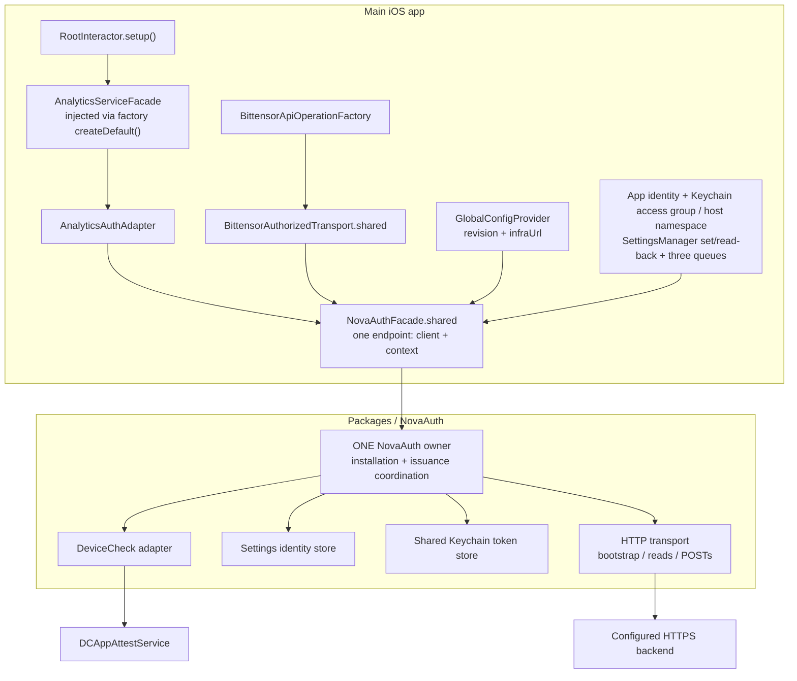
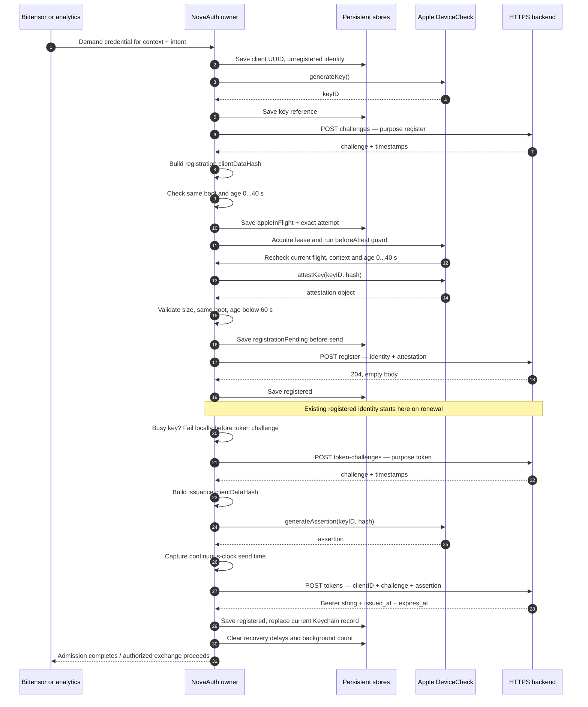
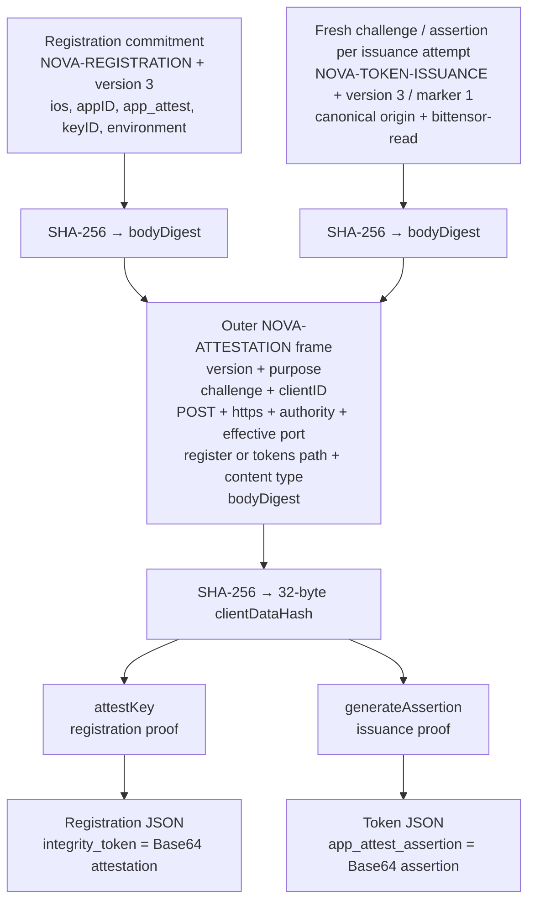
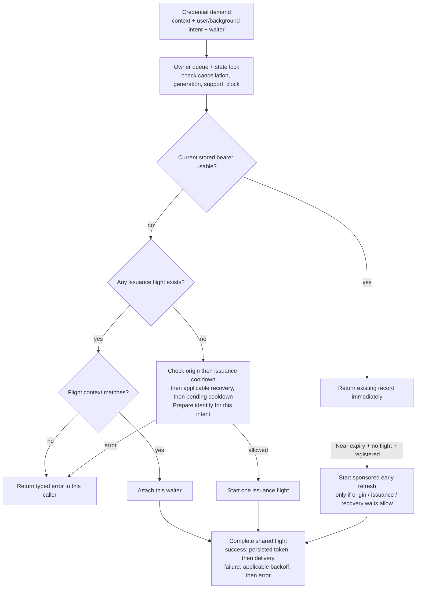
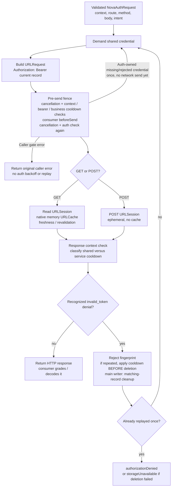
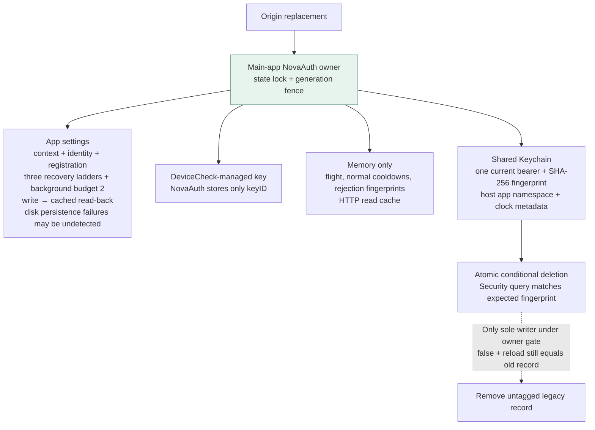
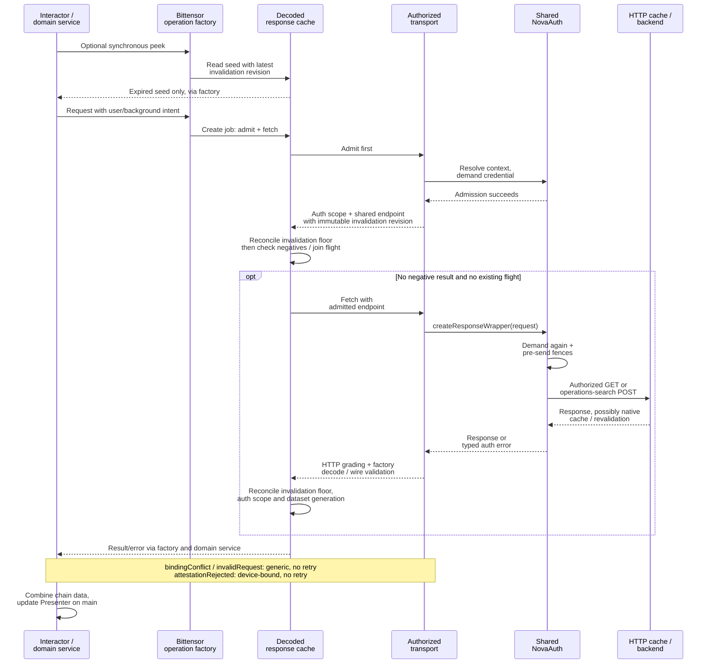
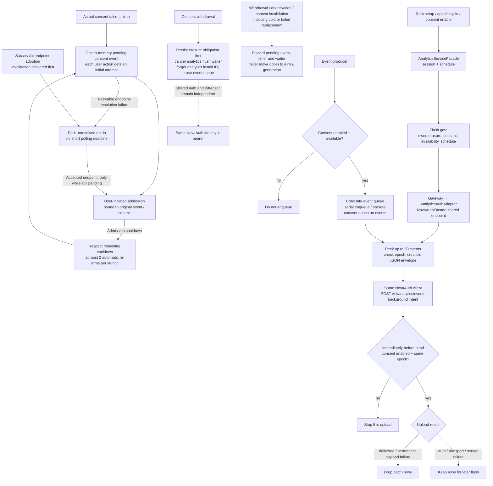

# NovaAuth — client architecture

Implementation snapshot: **`feature/nova-auth` · `db2cfe255` · 13 October 2026**.

These diagrams describe the Swift client on this branch. Architecture claims come from implementation and call-site searches, not the infrastructure PR or a planned design. “Backend” is only the HTTPS peer that the client calls; its internal behavior and deployed permissions are outside this document.

**Reading order:** ownership → first authentication → proof construction → registration recovery → token reuse/concurrency → protected requests → storage/replacement → Bittensor → analytics.

The central invariant is **one main-app NovaAuth owner, one installation identity, and one current persisted bearer for the active backend context**. Bittensor and analytics receive the same client. Requests already in flight can still hold the preceding valid bearer during refresh. Wallet accounts do not supply authentication keys.

## 1. Ownership and app composition

The facade is the app’s composition boundary. It creates the package owner once, resolves the current backend, and exposes an endpoint containing **the shared client + `(origin, generation)` context**. Activation establishes context; the first credential demand starts authentication.

- Root starts analytics before wallet setup. There is no `ServiceCoordinator → NovaAuth.setup` path; authentication is driven by consumer requests.
- The facade rejects unsupported App Attest, missing app identity/shared-store configuration, and real-client creation under `-UNITTEST`.
- Auth requires the shared Keychain access group and stable host namespace, but no longer resolves or requires an App Group filesystem container. Other host features still use that container.
- Settings writes use the injected manager and verify cached read-back. The production manager calls synchronize internally, but neither operation proves durability or detects every refused disk write.
- `infraUrl` may have an empty path or a single root `/`; the facade converts it into a strict HTTPS origin. Credentials, query, fragment and non-root paths are rejected. Older configuration revisions cannot replace a newer accepted snapshot.
- `appID` is App Identifier Prefix + bundle ID. `F_DEV` selects the development App Attest environment; other builds select production. This is distinct from wallet identity.
- Package code depends on Operation-iOS, NovaOperationSupport, Keystore-iOS and SDKLogger, with Apple platform adapters. It does not depend on app types.
- The facade compares a package invalidation ID around activation. Cold origin replacement/repair can invalidate observers before an endpoint was ever published; a failed replacement still notifies if its memory fence changed.

Sources: [facade and composition](../../../novawallet/Common/Network/Auth/NovaAuthFacade.swift) · [configuration conversion](../../../novawallet/Common/Network/Auth/NovaAuthFacade.swift) · [Root startup](../../../novawallet/Modules/Root/RootInteractor.swift) · [app identity](../../../novawallet/Common/Configs/ApplicationConfigs.swift) · [owner construction](../../../Packages/NovaAuth/Sources/NovaAuth/Lifecycle/NovaAuth.swift) · [package dependencies](../../../Packages/NovaAuth/Package.swift) · [host Keychain configuration](../../../novawallet/Configs/SharedContainerGroup.swift) · [cold context invalidation](../../../novawallet/Common/Network/Auth/NovaAuthFacade.swift) · [settings storage](../../../Packages/NovaAuth/Sources/NovaAuth/API/NovaAuthConfiguration.swift)

## 2. First authentication and subsequent issuance

This is the successful path for a new installation. All four backend calls are POSTs under `/v1/attestation/profile-3/`, with no bearer attached. Registration and token issuance are separate phases in the same coordinated flight.

The caller never gets a newly issued bearer before the Keychain write succeeds. The package treats the bearer as an opaque validated string; it does not decode claims. Challenge responses must describe a 60-second lifetime. Bearer responses must describe a lifetime of 60–900 seconds.

Apple attestation/assertion wrappers have a bounded timeout of up to 100 seconds. Once a native call begins, timeout/cancellation does not release its per-key lease: only Apple's actual callback does. A different key can proceed independently. Issuance checks `isBusy(keyID:)` before creating a token challenge, avoiding network traffic while the key is leased. The registration HTTP request allows 100 seconds; the other HTTP requests allow 20 seconds.

Registration age starts before the challenge request. The early check requires the same boot and `0 <= age <= 40`, choosing a minimum 20-second margin on the 60-second challenge. Exactly 40 seconds passes; 40.001 fails this check, retires `registrationAbandoned`, and requires user action for replacement. After Apple's result, same boot and `0 <= age < 60` remain authoritative: the 100-second local timeout means the margin cannot guarantee completion in time.

The early check runs before saving `appleInFlight` and building the wrapper. After acquiring the proof lease, the adapter invokes `beforeAttest` immediately before native `attestKey`; under the owner gate, this guard rechecks the current flight, context and the same inclusive 40-second budget. Queue delay therefore cannot use an earlier successful check to start an expired native attempt. Guard failure releases the **unused** lease without invoking Apple. The fenced completion retires an age-expired current attempt as `registrationAbandoned` once; a detached/stale flight cannot mutate a replacement context. After invocation the lease is **called** and only Apple's callback releases it, never a local timer.

Sources: [registration service](../../../Packages/NovaAuth/Sources/NovaAuth/Lifecycle/NovaAuthRegistrationService.swift) · [issuance and persistent installation](../../../Packages/NovaAuth/Sources/NovaAuth/Lifecycle/NovaAuthTokenProvider.swift) · [bootstrap endpoints](../../../Packages/NovaAuth/Sources/NovaAuth/HTTP/NovaAuthBootstrapOperationFactory.swift) · [response validation](../../../Packages/NovaAuth/Sources/NovaAuth/Wire/NovaAuthWire.swift) · [Apple adapter](../../../Packages/NovaAuth/Sources/NovaAuth/AppAttest/NovaAuthDeviceCheckService.swift) · [early and post-Apple age checks](../../../Packages/NovaAuth/Sources/NovaAuth/Lifecycle/NovaAuthRegistrationService.swift) · [installation and recovery clear](../../../Packages/NovaAuth/Sources/NovaAuth/Lifecycle/NovaAuthTokenProvider.swift) · [native execution guard](../../../Packages/NovaAuth/Sources/NovaAuth/Lifecycle/NovaAuthRegistrationService.swift) · [unused lease release and native invocation](../../../Packages/NovaAuth/Sources/NovaAuth/AppAttest/NovaAuthDeviceCheckService.swift)

## 3. What the App Attest proof binds

Registration and issuance use different semantic commitments. Each commitment is hashed and included in an outer frame that binds the challenge to the exact bootstrap request. Ordinary Bittensor and analytics requests carry the bearer; they do not get an App Attest assertion for each business payload.

- Text fields are ASCII with a 32-bit big-endian length prefix; domains have explicit NUL/version bytes. The semantic commitment is not a hash of the final JSON body containing the proof.
- `clientID` is a random installation UUID. `keyID` identifies the DeviceCheck-managed key. `appID` identifies the signed app. The context’s `generation` is a local invalidation fence; it is not included in these wire commitments.
- The source literally uses **`bittensor-read`** in issuance framing and token-record validation, even though the same bearer is attached to analytics and operations-search POSTs. This describes the client implementation; it does not establish which routes a deployed server accepts.
- `invalid_proof` at `/tokens` retains the key and assertion-counter continuity, then waits on the proof ladder before obtaining a fresh challenge/assertion. An Apple-deferred registration instead retries the exact saved key/hash within the original age window.

Sources: [exact binary framing](../../../Packages/NovaAuth/Sources/NovaAuth/Wire/NovaAuthFraming.swift) · [JSON fields](../../../Packages/NovaAuth/Sources/NovaAuth/Wire/NovaAuthWire.swift) · [identity types](../../../Packages/NovaAuth/Sources/NovaAuth/API/NovaAuthIdentity.swift) · [token flow validation](../../../Packages/NovaAuth/Sources/NovaAuth/Lifecycle/NovaAuthTokenValidation.swift) · [fresh proof retry classification](../../../Packages/NovaAuth/Sources/NovaAuth/Lifecycle/NovaAuthTokenProvider.swift)

## 4. Persisted registration state and recovery

The six named states below are the enum actually saved with the installation identity. State persistence makes crash/restart handling explicit. Arrows show transitions or the next demand’s recovery action; they are not timer-driven retries.

```mermaid
flowchart TB
  NEW(["New client UUID"]) --> U["unregistered"]
  U -- "Key + challenge" --> A["appleInFlight"]
  A -- "Valid attestation" --> P["registrationPending"]
  P -- "Register 204 / recovered token" --> R["registered"]
  A -- "Apple serverUnavailable" --> D["appleDeferred"]
  D -- "Same key / hash; early and native age at most 40 s" --> A
  A -- "Uncertain / old attempt; restart interrupted" --> X["retired<br/>reason + recreation ladder"]
  D -- "Expired saved attempt: abandoned" --> X
  P -- "Non-429 register 4xx: refused<br/>exhausted 401 unknown_client: abandoned" --> X
  R -- "401 unknown_client: abandoned<br/>invalid assertion key: lostKey" --> X
  X --> G{"Delay clear and permitted intent?"}
  G -- "Refused / abandoned / legacy: user only<br/>lostKey / interrupted: background budget below 2 or user" --> K["Write background reservation before generateKey<br/>keep retired reason until new key + UUID saved"]
  K --> U
  P -- "Later token-challenge probe" --> P
  R -- "Renew / retry binding policy / assertion timeout" --> R
  style X fill:#fff1e5,stroke:#c49366
  style R fill:#e7f4ee,stroke:#70a28b
```

| Situation | Implemented behavior |
| --- | --- |
| Restart finds `appleInFlight` | Retire `interrupted`; do not repeat the uncertain attestation. A later demand may recreate within the background budget or with user intent. |
| Apple attestation reports `serverUnavailable` | Save `appleDeferred`; retry the same key and saved hash under the original boot and both early/native 40-second checks. Expiry retires `registrationAbandoned`; the postcheck still requires age below 60 seconds. |
| Registration response is lost, 5xx or 429 | Preserve `registrationPending`; future demand probes token issuance with the existing identity. No registration-POST replay or new attestation. |
| Any non-429 registration 4xx | Retire `registrationRefused`, including `app_not_allowed`, `invalid_proof`, and uncoded/edge 4xx. No token-challenge probe for this refused identity. Replacement requires user intent. |
| Pending token-challenge probe | Persist cooldown **before** sending. Count only observed `unknown_client` responses, not offline, overloaded, interrupted or generic failed probes. Challenge success resets this count but keeps registration pending until a bearer is installed. |
| Pending `401 unknown_client` | Keep pending only on the same boot, elapsed time below 120 seconds, and resulting conclusive count below eight; otherwise retire `registrationAbandoned`. A registered identity receiving this response is also abandoned. The 120 seconds are not a blanket deadline for inconclusive pending failures; `404 unknown_client` is not conclusive here. |
| Assertion invalid key / timeout | Invalid key retires `lostKey`. Timeout preserves the key and registration; the actual callback alone releases the lease. |
| Other attestation failure/timeout or invalid-size object | Retire `registrationAbandoned`; replacement requires user intent. |
| Key generation fails | Initial generation retains the unregistered identity. Replacement retains the old retired reason and any consumed background reservation; apply issuance backoff without recursively generating again. |
| `binding_not_allowed` at token challenge or `/tokens` | Keep the binding; charge only the policy ladder, plus ordinary issuance backoff. Any intent may retry after the waits. |
| `invalid_proof` at `/tokens` | Keep the key; charge only the proof ladder, plus ordinary issuance backoff. Any intent may retry with a fresh proof after the waits. |
| Legacy `unrecoverableRegistration` | Decode only; same user-only replacement policy as `registrationAbandoned`. |
| Legacy `policyRefused` | Decode only; user intent first probes the existing binding as pending when a key exists, otherwise recreates. |

| Persisted recovery field | Charged once per event | Base ladder and cap |
| --- | --- | --- |
| `recreationDelay` | Retirement, not preparation/replacement start | 60 → 600 → 3,600 → 86,400 s; capped at 86,400 s |
| `policyRetryDelay` | `binding_not_allowed` at token challenge/issuance | 60 → 600 s; capped at 600 s |
| `proofRetryDelay` | `invalid_proof` at `/tokens` | 60 → 600 → 3,600 s; capped at 3,600 s |
| `backgroundRecreations` | Non-user replacement reservation before key generation | At most two since the last successful bearer installation; user actions consume none |

Each delay chooses its base tier before incrementing the failure count, then multiplies the capped base by `1 + 0.1 × random`: up to 10% jitter **above** the base cap. Mixed policy/proof failures do not advance the recreation ladder or spend its budget. A usable bearer wins before all these waits. Recreation delay applies only while retired; policy/proof delays apply once their respective failures have recorded them. User intent does not bypass a wait.

Every deadline is boot-scoped; a `kern.boottime` mismatch ends its wait without incrementing a tier or clearing the persisted count. The budget, rather than wall time, limits repeated background recreation. Legacy `recoveryCooldown` keeps its deadline but migrates to recreation tier zero. Successful bearer installation clears all recovery fields after the Keychain write; context replacement drops them.

The reservation is written through SettingsManager and read back before Apple key generation, and carried through state rebuilds. Detected storage errors close admission and retain the intended state for repair. Cancellation or interruption after a reservation can consume a slot without returning a key. A failed replacement retains its prior retired reason until the new client UUID/key are saved together. Undetected preference persistence failure can still lose the reservation on relaunch; view 7 describes this limit.

A first installation can be driven by background demand. Ordinary `lostKey`/`interrupted` recovery permits background replacement only within the two-reservation budget; refusal/abandonment requires user intent. An origin change, or repairing a legacy reset marker, sets `requiresUserAction = true`. An actual analytics opt-in can supply user intent through the bounded re-arm in view 9; restoring saved consent or merely uploading events cannot. The package has no explicit reset API.

Sources: [persisted state enum](../../../Packages/NovaAuth/Sources/NovaAuth/Contracts/NovaAuthModels.swift) · [identity gates and state dispatch](../../../Packages/NovaAuth/Sources/NovaAuth/Lifecycle/NovaAuthRegistrationService.swift) · [registration error handling](../../../Packages/NovaAuth/Sources/NovaAuth/Lifecycle/NovaAuthRegistrationService.swift) · [persisted probe reservation](../../../Packages/NovaAuth/Sources/NovaAuth/Lifecycle/NovaAuthPendingRecovery.swift) · [common failure handling](../../../Packages/NovaAuth/Sources/NovaAuth/Lifecycle/NovaAuthTokenProvider.swift) · [retirement reason policy](../../../Packages/NovaAuth/Sources/NovaAuth/Contracts/NovaAuthModels.swift) · [recovery ladders and reservations](../../../Packages/NovaAuth/Sources/NovaAuth/Lifecycle/NovaAuthRecoveryService.swift) · [retirement charge](../../../Packages/NovaAuth/Sources/NovaAuth/Lifecycle/NovaAuthRecoveryService.swift) · [ladder calculation](../../../Packages/NovaAuth/Sources/NovaAuth/Lifecycle/NovaAuthCooldown.swift) · [legacy migration](../../../Packages/NovaAuth/Sources/NovaAuth/Contracts/NovaAuthModels.swift) · [replacement reservation](../../../Packages/NovaAuth/Sources/NovaAuth/Lifecycle/NovaAuthRecoveryService.swift)

## 5. Token reuse, refresh and concurrency

Every admission consults the shared current record. Consumers wait on the same issuance flight when there is no usable bearer. When the bearer remains usable, a request can proceed immediately while an early refresh runs alongside it.

**Validity:** matching version/context/clientID/flow; no local rejection fingerprint; valid opaque token syntax; same boot; consistent monotonic timestamps; server lifetime 60–900 seconds. The effective deadline is:

`local token-POST send time + (expires_at − issued_at) − 5 seconds`

Early refresh begins on demand when effective remaining time reaches a stored, randomized threshold of approximately **20–26.67% of the original lifetime**. There is no scheduled refresh timer. Main-owner admission returns a valid bearer before origin, issuance, recovery or pending waits; refresh respects its applicable waits. Without a valid bearer, an existing flight is joined before starting a new one. Business sending separately checks shared-origin and family cooldowns, even when admission already returned a bearer.

Ordinary issuance Retry-After is in memory and restarting the owner loses that delay: this is an accepted limitation. Pending-registration cooldown and the three recovery ladders are persisted. Reboot ends their current waits, but never resets the persisted background recreation count or advances a tier.

| Execution lane | Responsibility |
| --- | --- |
| Feature queues | Compose wrappers and await results without blocking the owner’s work. |
| `nova.auth.owner` · serial | Credential demand, issuance coordination, state transitions and delivery; state also guarded by `NSLock`. |
| `nova.auth.bootstrap` · maximum 4 operations | Independently runnable Apple and bootstrap HTTP child operations. One logical issuance flight is coordinated above this queue. |
| `nova.auth.requests` · default concurrency | Parallel protected business requests. |
| Analytics persistence queue · serial | Event enqueue/trim/count and erasure; upload peek/drop execute on the configured general upload queue. |

Cancelling a consumer removes only its waiter. The last waiter cancels an issuance child only when the flight is **neither sponsored nor irreversible**. Irreversibility begins before Apple attestation or assertion. A cancelled analytics upload therefore does not abort another consumer’s issuance. Origin replacement detaches the old flight immediately; its late callback cannot affect the new context. Platform calls already started cannot be cancelled at the Apple API level; wrappers settle once, but the same key stays reserved until the actual callback. If Apple never calls back, that key remains busy until process restart.

`issue()` fails locally on a busy key before creating the token-challenge wrapper. It does not release a lease on a timer or consume another native attempt while the first call remains active.

Sources: [demand and token loading](../../../Packages/NovaAuth/Sources/NovaAuth/Lifecycle/NovaAuthTokenProvider.swift) · [early refresh and cancellation](../../../Packages/NovaAuth/Sources/NovaAuth/Lifecycle/NovaAuthTokenProvider.swift) · [validity checks](../../../Packages/NovaAuth/Sources/NovaAuth/Lifecycle/NovaAuthTokenValidation.swift) · [queue composition](../../../novawallet/Common/Operation/OperationManagerFacade.swift) · [child scheduling and delivery](../../../Packages/NovaAuth/Sources/NovaAuth/Lifecycle/NovaAuth.swift) · [busy-key short-circuit](../../../Packages/NovaAuth/Sources/NovaAuth/Lifecycle/NovaAuthTokenProvider.swift) · [issuance and pending backoff](../../../Packages/NovaAuth/Sources/NovaAuth/Lifecycle/NovaAuthPendingRecovery.swift)

## 6. Protected requests, HTTP cache and bounded renewal

This diagram shows the main-app owner. Admission is repeated for the actual exchange, even if a consumer already obtained preliminary admission. Immediately before the URLSession task starts, NovaAuth checks the context and credential around the consumer’s own send gate. This also happens before a native cached read can be returned.

**The renewal trigger is narrow:** same HTTPS origin and port, status 401, exactly one `WWW-Authenticate` header equal to `Bearer error="invalid_token"`, plus a parsed `invalid_token` error. An unrelated 401/403 does not trigger this recovery. The same request may be replayed once after re-admission; there is no general business-request retry loop here.

A separate one-time re-admission handles NovaAuth discovering an unusable credential before any send. It does not consume or enlarge the sent-response replay budget: at most two actual business sends are possible, with identical POST bytes and repeated caller gates. Cancellation ownership is installed atomically with enqueue, so a pending child cannot be cancelled into a finished state before being submitted to its queue.

Repeated denial applies the owner's issuance cooldown **before** throwing token deletion, so storage failure cannot skip it. The rejection fingerprint also prevents reuse. Terminal business-exchange completion releases the cancellation action before delivering or suppressing the result, breaking its retained child/exchange chain.

| Transport | Configuration and cache behavior |
| --- | --- |
| Bootstrap | Ephemeral session, no bearer, no URLCache; only four allowlisted POST paths. |
| GET business reads | Default session with a private 16 MiB **memory-only** URLCache. Native HTTP policy decides freshness and revalidation. |
| Business POST | Ephemeral session, no cache. Both analytics and operations search use this lane. |
| All three | No cookie or URL credential storage; redirects rejected; default server-trust handling; other URL authentication challenges rejected. |

Read-cache writes require 2xx and `Cache-Control: public`, without `private`/`no-store`, identity-bearing response headers or identity-sensitive `Vary`/`*`. Response bodies are bounded to 16 KiB for bootstrap and 32 MiB for business traffic. URL length is bounded to 2,048 UTF-8 bytes.

| Business result | Applied cooldown |
| --- | --- |
| 429 | Shared origin; numeric `Retry-After` or 30 seconds. |
| Uncoded 500 | Shared origin. This client heuristic does not identify the failing server component. |
| Explicit 503 `attestation_unavailable` | Shared origin. |
| Uncoded 502/503/504, other 5xx, and coded domain 5xx except the explicit shared case | Analytics or Bittensor family only. |
| Business transport failure | The request's family only. |

“Uncoded” means no valid code was parsed by `NovaAuthWire`. Family and shared-origin waits are checked at business send, including before native cache access; a usable bearer still passes main-owner token admission. Default short backoff is 1, 2, 4, 8, 16, 30 seconds plus up to one second of jitter; numeric explicit delay is clamped to 1–905 seconds. Expiry does not schedule an automatic retry. A concurrent success does not shorten an active cooldown or clear the other service's failure.

**Client route allowlist**

| Method | Path |
| --- | --- |
| GET | `/v1/bittensor/profile-3/subnets` |
| GET | `/v1/bittensor/profile-3/subnets/{netuid}/validators` |
| GET | `/v1/bittensor/profile-3/yields/root` |
| GET | `/v1/bittensor/profile-3/subnets/{netuid}/yields/alpha` |
| GET | `/v1/bittensor/profile-3/recommendations` |
| GET | `/v1/bittensor/profile-3/recommendations/subnets` |
| GET | `/v1/bittensor/profile-3/recommendations/subnets/{netuid}/validators` |
| POST · JSON | `/v1/bittensor/operations/search` |
| POST · JSON | `/v1/analytics/events` |

`netuid` must be canonical UInt16 text. The current Bittensor factory does not expose the per-subnet recommendation-validators route. The table shows the package allowlist, not a claim that every route has an active caller.

**Separately owned server migration:** release coordination must confirm that both existing POST paths accept this same profile-3 `bittensor-read` bearer and that `invalid_token` is rejected **before either POST reaches its business handler**. This pre-handler contract permits the single replay of identical bytes. The client predicate cannot establish deployed server ordering. There is no legacy fallback or client backend migration here.

Sources: [authorized exchange](../../../Packages/NovaAuth/Sources/NovaAuth/Authorization/NovaAuthAuthorizedOperationFactory.swift) · [denial predicate](../../../Packages/NovaAuth/Sources/NovaAuth/Authorization/NovaAuthBearerDenial.swift) · [owner send/response gates](../../../Packages/NovaAuth/Sources/NovaAuth/Authorization/NovaAuth+Authorization.swift) · [HTTP sessions](../../../Packages/NovaAuth/Sources/NovaAuth/HTTP/NovaAuthHTTPTransport.swift) · [cache acceptance](../../../Packages/NovaAuth/Sources/NovaAuth/HTTP/NovaAuthHTTPDelegate.swift) · [route allowlist](../../../Packages/NovaAuth/Sources/NovaAuth/Wire/NovaAuthRoute.swift) · [service cooldown classification](../../../Packages/NovaAuth/Sources/NovaAuth/Authorization/NovaAuthBusinessCooldowns.swift) · [cooldown](../../../Packages/NovaAuth/Sources/NovaAuth/Lifecycle/NovaAuthCooldown.swift) · [denial ordering and writer cleanup](../../../Packages/NovaAuth/Sources/NovaAuth/Authorization/NovaAuth+Authorization.swift) · [terminal cancellation release](../../../Packages/NovaAuth/Sources/NovaAuth/Authorization/NovaAuthAuthorizedOperationFactory.swift)

## 7. Persistence and origin replacement

Identity state and bearer state share the main-app owner but have different storage boundaries and policies.

| Store | Contents and behavior |
| --- | --- |
| App settings record | Versioned installation state, optional client/key references, six-state registration machine, saved Apple attempt, conclusive unknown-response count/backoff, three recovery ladders, background recreation count and owed-deletion marker. State writes use SettingsManager and cached read-back; disk persistence failures may be undetected. Corruption is distinguished from transient failure and repair gates admission. |
| Shared Keychain record | One `current` record in `io.novawallet.novaauth.profile3.<hostAppNamespace>`; access group from shared configuration; `AfterFirstUnlockThisDeviceOnly`. Canonical record bytes and their SHA-256 fingerprint are written atomically. Invalid serialized records return no usable bearer without a destructive read. |
| Store synchronization | Process-local mutation mutex for writer replacement/removal. Conditional deletion is one Security query matching the expected fingerprint, protecting a newer record without a cross-process file lock. Legacy untagged records remain readable and renewal tags them. On rejection or invalidity only the main writer can fall back to `removeAll()` when conditional deletion returns false and reload still equals that record, under its sole-writer gate. |
| Clock metadata | `mach_continuous_time` and boot ID derived from `kern.boottime`. Reboot/boot-ID mismatch makes the stored bearer unusable; remaining life is not calculated by comparing device wall time with server timestamps. |
| Memory | Flight/waiters, ordinary issuance/origin/family cooldowns, rejected-token fingerprints, context invalidation ID and read cache. Losing ordinary issuance Retry-After on restart is accepted. Pending-registration and recovery waits/count persist in settings. A failed intended state write remains pending for retry and raises `storageFailed`. |

**Origin replacement:**

1. Advance the in-memory context generation; discard the local identity reference; require user action.
2. Detach the old flight and fail its waiters with `generationChanged`. Cancel a reversible child; irreversible work can finish independently, but cannot install into the replaced context.
3. Clear in-memory cooldowns, rejected fingerprints and native read cache; replacement settings omit old recovery ladders/count.
4. Persist replacement settings with an owed-deletion marker, remove the shared bearer, then clear the marker. Failure leaves the memory fence and retryable storage work in place; a persisted deletion obligation survives restart. Admission remains closed until repair completes.
5. Adoption compares the package invalidation ID around activation and also notifies on a failed replacement/repair if the memory fence changed. This works before the facade has published its first endpoint: cold origin replacement discards pending consent events and old Bittensor state. A later user-initiated demand can establish the next identity.

There is no explicit reset API. Activation repairs corrupt identity storage: it advances past any stored bearer's generation, removes that orphan bearer and clears the read cache. A legacy reset marker written by an earlier build is repaired the same way into a context that still requires user action. A temporary storage read failure is not treated as corruption.

The implementation does not delete an App Attest key through DeviceCheck or globally cancel already-sent business HTTP. Stale business responses are rejected by the context check. Shared-store compare-and-delete prevents an old denial from deleting a replacement token.

**Settings persistence boundary:** state writes use SettingsManager set/read-back. The production manager invokes `UserDefaults.synchronize()` internally; cached read-back and that return value do not prove a durable write. There is no extra commit callback. Detected validation/read-back failure retains the pending state and blocks admission until activation repairs it. Reservation-before-key ordering remains, but a refused preference write can be undetected and the budget lost on relaunch. Bearer and recovery writes are not one atomic transaction; interruption after the bearer write can conservatively retain the old recovery budget.

Auth needs the Keychain access group, not an App Group filesystem container. The privacy manifest no longer declares FileTimestamp/C617.1. Diagnostics emit fixed retirement reasons, typed `shared`/`family`/`recreation`/`policy`/`proof` cooldown scopes, and `storageFailed` on entering failed/dirty storage state; local-recovery delay metadata accommodates the ladder's 95,040-second maximum including jitter.

Sources: [state and repair](../../../Packages/NovaAuth/Sources/NovaAuth/Lifecycle/NovaAuth.swift) · [context replacement](../../../Packages/NovaAuth/Sources/NovaAuth/Lifecycle/NovaAuth.swift) · [settings store](../../../Packages/NovaAuth/Sources/NovaAuth/Storage/NovaAuthSettingsIdentityStore.swift) · [Keychain store](../../../Packages/NovaAuth/Sources/NovaAuth/Storage/NovaAuthKeychainTokenStore.swift) · [clock](../../../Packages/NovaAuth/Sources/NovaAuth/Clock/NovaAuthContinuousClock.swift) · [typed retirement/cooldown diagnostics](../../../Packages/NovaAuth/Sources/NovaAuth/Authorization/NovaAuthDiagnostics.swift) · [storage failure transition](../../../Packages/NovaAuth/Sources/NovaAuth/Lifecycle/NovaAuth.swift) · [auth shared-store fields](../../../Packages/NovaAuth/Sources/NovaAuth/API/NovaAuthConfiguration.swift) · [state write/read-back](../../../Packages/NovaAuth/Sources/NovaAuth/Storage/NovaAuthSettingsIdentityStore.swift) · [settings persistence boundary](../../../Packages/NovaAuth/Sources/NovaAuth/Storage/NovaAuthSettingsIdentityStore.swift) · [exact pending-state repair](../../../Packages/NovaAuth/Sources/NovaAuth/Lifecycle/NovaAuth.swift)

## 8. Bittensor: admission, two cache layers and presentation

Bittensor adds domain request sharing, decoded display seeds and typed error handling around NovaAuth. Its decoded cache never substitutes for native HTTP freshness. On-chain balances and chain enrichment use the chain connection separately from NovaAuth.

- Auth admission precedes negative-cache lookup and joining a request flight. Synchronous `peek` is only a stale display seed and makes no authentication request.
- Decoded cache keys include auth scope plus method/path/query/body digest. Route-unpublished negatives last 600 seconds; dataset-unavailable negatives last 60 seconds. There is no successful-response TTL shortcut here.
- Recommendation dataset ordering uses `(asOf, sourceBlockNumber)`. It is distinct from the authentication generation. An older dataset response returns `generationStale` without overwriting the newer seed.
- The facade stamps accepted endpoints with an invalidation revision; transport preserves it in each admission. The decoded cache reconciles the latest revision before admission, completion and peek. Delayed or duplicate notifications cannot retire current-revision state; old admissions and completions cannot restore retired results. Same-origin readiness does not advance this invalidation revision. Separate context observers invalidate max-APY resolution, cost-basis histories and validator directories, including cold replacement or a failed replacement after the memory fence changes.
- Cost basis/P&L reads **`POST /v1/bittensor/operations/search`** and computes the ledger locally. It is a history read, not transaction submission.
- Screen entry and explicit catalogue refresh carry user intent; automatic portfolio changes, pricing, cost-basis and max-APY work carry background intent. `withIntent` shares the same transport and cache.
- Errors are graded into Bittensor types. Raw network and malformed-protocol failures retain retryable availability meaning; generic business 401/403 are server errors after the scope-specific case below. Presentation depends on the consumer: portfolio catalogue failure supplies no catalogue and can show rates unavailable; validator flows use the typed device/retry properties. Live chain balances do not prove successful backend authentication.

| Response/error | Bittensor type | Device-bound | User retry |
| --- | --- | --- | --- |
| Bootstrap `401 attestation_failed` | `attestationRejected` | Yes | No |
| `409 client_already_registered`, bootstrap or business | `bindingConflict` | No | No |
| `403 insufficient_scope`, bootstrap or business | `invalidRequest` (generic presentation) | No | No |
| Bootstrap `401 invalid_challenge` or 503 | `attestationUnavailable` | No | Yes |
| Transport failure | `transport` | No | Yes |

These presentation mappings are separate from NovaAuth cooldown scope. For example, the Bittensor grader maps uncoded business 5xx to `attestationUnavailable`, while NovaAuth shares only uncoded 500; uncoded 502/503/504 remain family-scoped as in view 6.

The max-APY walk stops on registration refusal, binding conflict, final authorization denial, unsupported device, configuration failure or authentication backoff. It propagates that error without an outer retry or a successful partial result, so the one-hour result cache remains empty. Ordinary route/data gaps can still skip a target, and transient failures keep their bounded retry policy.

Sources: [shared domain composition](../../../novawallet/Modules/Staking/Model/StakingSharedState/StakingSharedStateFactory+Subtensor.swift) · [transport admission and send](../../../novawallet/Common/Network/Bittensor/Transport/BittensorAuthorizedTransport.swift) · [factory and decoding](../../../novawallet/Common/Network/Bittensor/BittensorApiOperationFactory.swift) · [decoded cache](../../../novawallet/Common/Network/Bittensor/BittensorApiResponseCache.swift) · [HTTP/auth error grading](../../../novawallet/Common/Network/Bittensor/Transport/BittensorAuthorizedResponseGrader.swift) · [portfolio refresh/failure](../../../novawallet/Modules/Staking/Subtensor/SubtensorPortfolio/SubtensorPortfolioInteractor.swift) · [device/retry properties](../../../novawallet/Common/Network/Bittensor/BittensorApiError+Recovery.swift) · [bootstrap error mapping](../../../novawallet/Common/Network/Bittensor/Transport/BittensorAuthorizedResponseGrader.swift)

## 9. Analytics: shared authentication, separate consent and data

Analytics owns event collection, its own installation/session identifiers, consent epochs, persistence and upload scheduling. None of those create a second authentication identity or bearer. The adapter resolves the same NovaAuth endpoint used by Bittensor.

A background flush sends at most one batch; other flushes send at most ten. The before-send callback runs inside NovaAuth’s send fences and is rechecked on a bearer-recovery replay. Disabling analytics cancels its waiter and retains the erasure obligation until the analytics queue is actually wiped. Re-enabling rotates the analytics consent epoch/session.

The analytics identifiers belong to telemetry content. The authentication `clientID`, DeviceCheck key and current bearer belong to NovaAuth. Consent erasure does not reset any of those. Uploads always use background intent. An actual false-to-true consent action separately creates one pending event for user-initiated admission on the same client; saved consent at launch and foreground transitions do not.

Every genuine opt-in gets an initial attempt. Retryable endpoint-resolution failures park that event until a successful endpoint adoption, without a three-second polling deadline. A readiness payload resumes only an unresolved pending event; it cannot duplicate an admission already underway or revive a discarded event. Only automatic admission-cooldown re-arms spend the launch-wide budget of two retries, and they respect the complete remaining cooldown. Other admission failures finish the event. Withdrawal, deactivation/throttle and context invalidation discard the waiter/timer. The facade publishes invalidation before readiness, including cold replacement, and the event/context fences reject stale delivery. An opt-in is never moved to a replacement generation.

**Accepted D3 limitation:** after an origin change, an install with analytics consent on and no Bittensor use uploads nothing. Uploads can resume after a real Bittensor user action or a consent off/on cycle, subject to admission and the bounded re-arm. An opt-in whose own initial resolution performs a cold origin replacement is discarded too; a later real action is required. Automatic uploads and restored consent do not re-authorize that context. Ordinary lost-key/interrupted recovery can run on background demand only within the persisted budget of two; registration refusal/abandonment and the legacy user-only states require user intent.

Sources: [host injection](../../../novawallet/Common/Services/Analytics/AnalyticsFacadeFactory.swift) · [endpoint adapter](../../../novawallet/Common/Services/Analytics/AnalyticsAuthAdapter.swift) · [analytics composition](../../../Packages/NovaAnalytics/Sources/NovaAnalytics/AnalyticsServiceFacade.swift) · [flush and consent handling](../../../Packages/NovaAnalytics/Sources/NovaAnalytics/AnalyticsService.swift) · [batch and send guard](../../../Packages/NovaAnalytics/Sources/NovaAnalytics/AnalyticsUploader.swift) · [POST construction](../../../Packages/NovaAnalytics/Sources/NovaAnalytics/Network/AnalyticsUploadOperationFactory.swift) · [consent withdrawal ordering](../../../Packages/NovaAnalytics/Sources/NovaAnalytics/AnalyticsConsentManager.swift) · [consent retry budget](../../../Packages/NovaAnalytics/Sources/NovaAnalytics/AnalyticsConsentAuthRecovery.swift) · [consent retry scheduling](../../../Packages/NovaAnalytics/Sources/NovaAnalytics/AnalyticsConsentAuthRecovery.swift) · [facade invalidation](../../../novawallet/Common/Network/Auth/NovaAuthFacade.swift)

The consent action is implemented by [AnalyticsConsentAuthRecovery](../../../Packages/NovaAnalytics/Sources/NovaAnalytics/AnalyticsConsentAuthRecovery.swift). Authentication diagnostics use [fixed phases, retirement reasons, cooldown scopes and sanitized fields](../../../Packages/NovaAuth/Sources/NovaAuth/Authorization/NovaAuthDiagnostics.swift); bearer, client/key IDs, proofs and response bodies are never logged.
