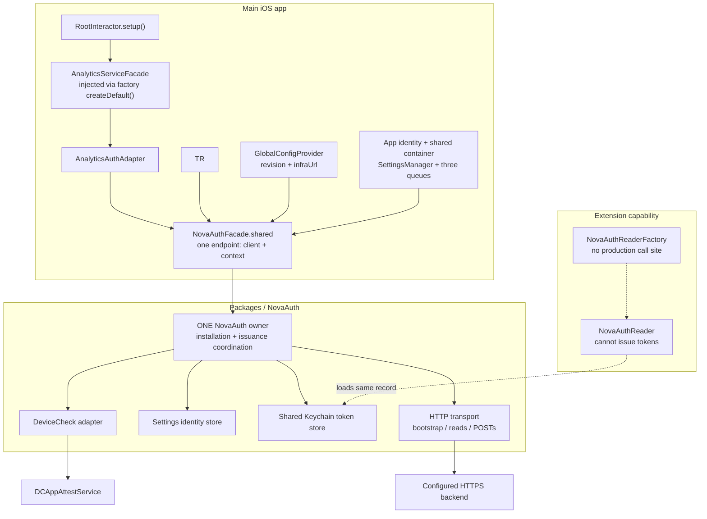
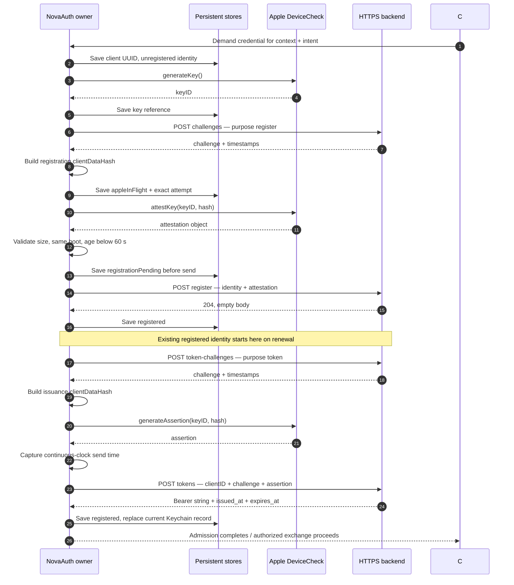
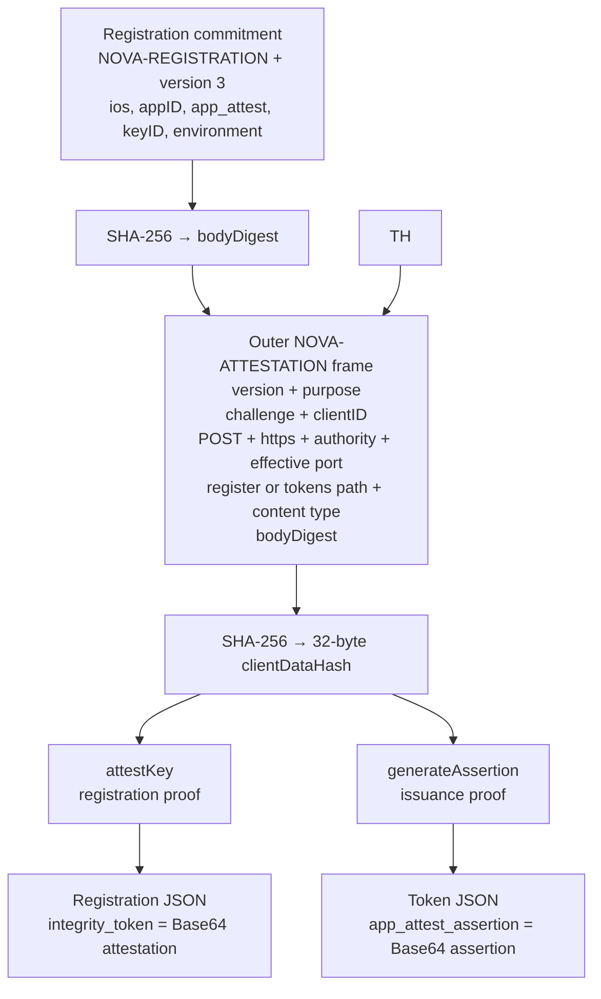
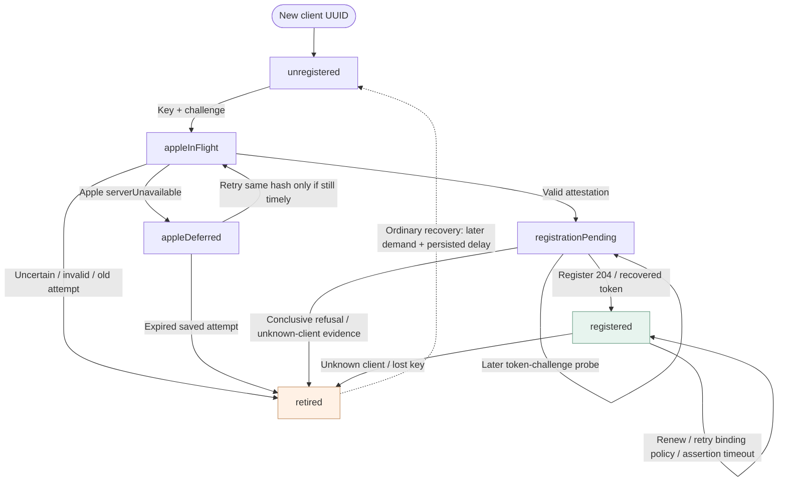
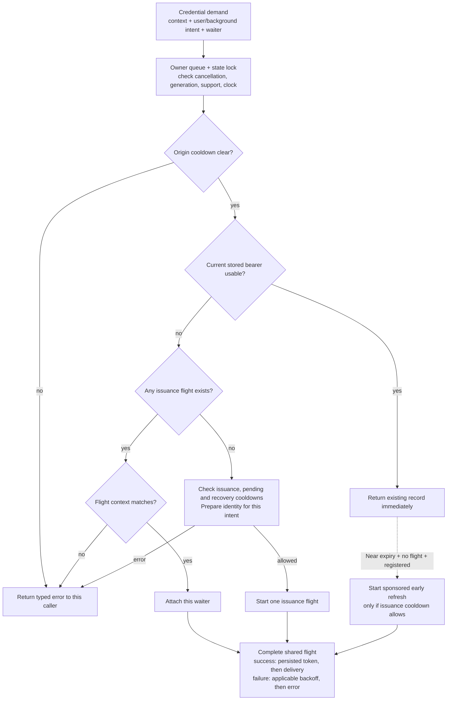
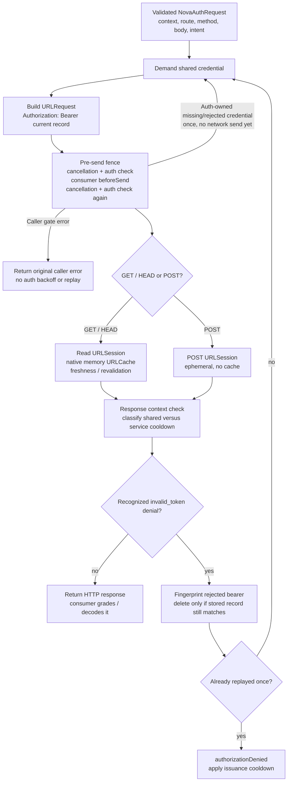
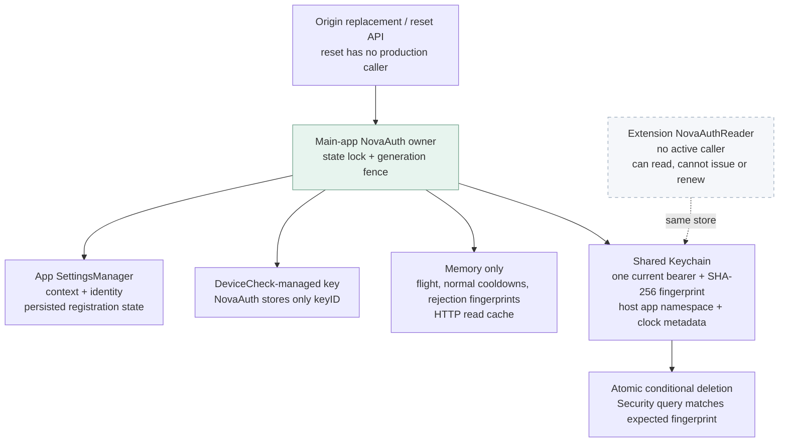
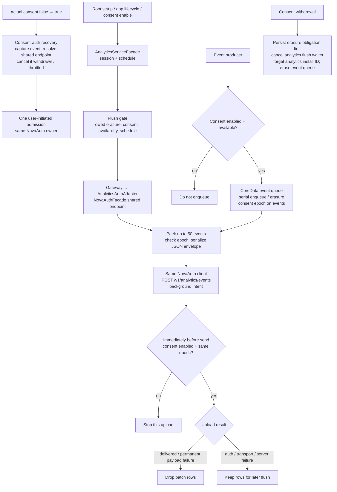

# NovaAuth — client architecture

These diagrams describe the Swift client. “Backend” is only the HTTPS peer that the client calls; its internal behavior and deployed permissions are outside this document.

The central invariant is **one main-app NovaAuth owner, one installation identity, and one current persisted bearer for the active backend context**. analytics receive the same client. Requests already in flight can still hold the preceding valid bearer during refresh. Wallet accounts do not supply authentication keys.

## 1. Ownership and app composition

The facade is the app’s composition boundary. It creates the package owner once, resolves the current backend, and exposes an endpoint containing **the shared client + `(origin, generation)` context**. Activation establishes context; the first credential demand starts authentication.

- Root starts analytics before wallet setup. There is no `ServiceCoordinator → NovaAuth.setup` path; authentication is driven by consumer requests.
- The facade rejects unsupported App Attest, missing app identity/shared-store configuration, and real-client creation under `-UNITTEST`.
- `infraUrl` may have an empty path or a single root `/`; the facade converts it into a strict HTTPS origin. Credentials, query, fragment and non-root paths are rejected. Older configuration revisions cannot replace a newer accepted snapshot.
- `appID` is App Identifier Prefix + bundle ID. `F_DEV` selects the development App Attest environment; other builds select production. This is distinct from wallet identity.
- Package code depends on Operation-iOS, NovaOperationSupport, Keystore-iOS and SDKLogger, with Apple platform adapters. It does not depend on app types.

Sources: [facade and composition](/Users/svojs/Documents/workspace/nova-wallet-ios/novawallet/Common/Network/Auth/NovaAuthFacade.swift:121) · [configuration conversion](/Users/svojs/Documents/workspace/nova-wallet-ios/novawallet/Common/Network/Auth/NovaAuthFacade.swift:80) · [Root startup](/Users/svojs/Documents/workspace/nova-wallet-ios/novawallet/Modules/Root/RootInteractor.swift:146) · [app identity](/Users/svojs/Documents/workspace/nova-wallet-ios/novawallet/Common/Configs/ApplicationConfigs.swift:223) · [owner construction](/Users/svojs/Documents/workspace/nova-wallet-ios/Packages/NovaAuth/Sources/NovaAuth/Lifecycle/NovaAuth.swift:16) · [package dependencies](/Users/svojs/Documents/workspace/nova-wallet-ios/Packages/NovaAuth/Package.swift:6) · [extension factory](/Users/svojs/Documents/workspace/nova-wallet-ios/NovaPushNotificationServiceExtension/NovaAuthReaderFactory.swift:5)

## 2. First authentication and subsequent issuance

This is the successful path for a new installation. All four backend calls are POSTs under `/v1/attestation/profile-3/`, with no bearer attached. Registration and token issuance are separate phases in the same coordinated flight.

The caller never gets a newly issued bearer before the Keychain write succeeds. The package treats the bearer as an opaque validated string; it does not decode claims. Challenge responses must describe a 60-second lifetime. Bearer responses must describe a lifetime of 60–900 seconds.

Apple attestation/assertion wrappers have a bounded timeout of up to 100 seconds. A timeout or cancellation does not release the per-key native-call lease: only Apple's actual callback does. A different key can proceed independently. The registration HTTP request allows 100 seconds; the other HTTP requests allow 20 seconds. The 60-second registration-age check is separate, includes time starting before the challenge request, and runs before a saved attestation attempt is sent to Apple as well as after its result.

Sources: [registration service](/Users/svojs/Documents/workspace/nova-wallet-ios/Packages/NovaAuth/Sources/NovaAuth/Lifecycle/NovaAuthRegistrationService.swift:96) · [issuance and persistent installation](/Users/svojs/Documents/workspace/nova-wallet-ios/Packages/NovaAuth/Sources/NovaAuth/Lifecycle/NovaAuthTokenProvider.swift:76) · [bootstrap endpoints](/Users/svojs/Documents/workspace/nova-wallet-ios/Packages/NovaAuth/Sources/NovaAuth/HTTP/NovaAuthBootstrapOperationFactory.swift:14) · [response validation](/Users/svojs/Documents/workspace/nova-wallet-ios/Packages/NovaAuth/Sources/NovaAuth/Wire/NovaAuthWire.swift:38) · [Apple adapter](/Users/svojs/Documents/workspace/nova-wallet-ios/Packages/NovaAuth/Sources/NovaAuth/AppAttest/NovaAuthDeviceCheckService.swift:21)

## 3. What the App Attest proof binds

Registration and issuance use different semantic commitments. Each commitment is hashed and included in an outer frame that binds the challenge to the exact bootstrap request. Ordinary analytics requests carry the bearer; they do not get an App Attest assertion for each business payload.

- Text fields are ASCII with a 32-bit big-endian length prefix; domains have explicit NUL/version bytes. The semantic commitment is not a hash of the final JSON body containing the proof.
- `clientID` is a random installation UUID. `keyID` identifies the DeviceCheck-managed key. `appID` identifies the signed app. The context’s `generation` is a local invalidation fence; it is not included in these wire commitments.
This describes the client implementation; it does not establish which routes a deployed server accepts.

Sources: [exact binary framing](/Users/svojs/Documents/workspace/nova-wallet-ios/Packages/NovaAuth/Sources/NovaAuth/Wire/NovaAuthFraming.swift:5) · [JSON fields](/Users/svojs/Documents/workspace/nova-wallet-ios/Packages/NovaAuth/Sources/NovaAuth/Wire/NovaAuthWire.swift:12) · [identity types](/Users/svojs/Documents/workspace/nova-wallet-ios/Packages/NovaAuth/Sources/NovaAuth/API/NovaAuthIdentity.swift:20) · [token flow validation](/Users/svojs/Documents/workspace/nova-wallet-ios/Packages/NovaAuth/Sources/NovaAuth/Lifecycle/NovaAuthTokenValidation.swift:4)

## 4. Persisted registration state and recovery

The six named states below are the enum actually saved with the installation identity. State persistence makes crash/restart handling explicit. Arrows show transitions or the next demand’s recovery action; they are not timer-driven retries.

| Situation | Implemented behavior |
| --- | --- |
| Restart finds `appleInFlight` | Retire as unrecoverable; do not repeat that uncertain attestation. |
| Apple attestation reports `serverUnavailable` | Save `appleDeferred`; retry the same key and saved hash only while the original age/boot check still passes. An already-expired attempt retires before calling Apple. |
| Registration response is lost, 5xx, 429, or `invalid_proof` | Preserve `registrationPending`; future demand uses token issuance with the existing identity. No registration-POST replay or new attestation. |
| Pending token-challenge probe | Persist cooldown **before** sending. Count only observed `unknown_client` responses, not offline, overloaded, interrupted or generic failed probes. Challenge success resets this count but keeps registration pending until a bearer is installed. |
| Pending `unknown_client` | Keep pending only on the same boot, elapsed time below 120 seconds, and resulting conclusive count below eight. The 120 seconds are not a blanket deadline for all pending recovery. |
| Assertion invalid key / timeout | An invalid assertion key retires as `lostKey`. An assertion timeout preserves the key and registration. An uncertain one-time attestation remains conservatively unrecoverable. |
| Key generation fails | Keep the unregistered identity and apply issuance backoff; no registration has been sent. |
| `binding_not_allowed` | Preserve the existing binding and usable bearer; later demand may retry the same binding after a persisted delay. |
| `app_not_allowed` / legacy `policyRefused` | Require user intent for recovery. Legacy ambiguous policy state first probes its existing binding when possible. |
| `lostKey` / `unrecoverableRegistration` | Later background or user demand may create a new client UUID and key. A persisted minimum of 60 seconds bounds recreation; a failed flight does not recursively register again. |

A first installation and ordinary lost-key recovery can be driven by background demand. Reset of an existing installation or an origin change sets `requiresUserAction = true`, so creating the next identity requires user intent. An actual analytics opt-in provides such an action; restoring saved consent or merely uploading events does not. The public reset has no current production caller.

Sources: [persisted state enum](/Users/svojs/Documents/workspace/nova-wallet-ios/Packages/NovaAuth/Sources/NovaAuth/Contracts/NovaAuthModels.swift:90) · [identity gates and state dispatch](/Users/svojs/Documents/workspace/nova-wallet-ios/Packages/NovaAuth/Sources/NovaAuth/Lifecycle/NovaAuthRegistrationService.swift:5) · [registration error handling](/Users/svojs/Documents/workspace/nova-wallet-ios/Packages/NovaAuth/Sources/NovaAuth/Lifecycle/NovaAuthRegistrationService.swift:199) · [persisted probe reservation](/Users/svojs/Documents/workspace/nova-wallet-ios/Packages/NovaAuth/Sources/NovaAuth/Lifecycle/NovaAuthPendingRecovery.swift:4) · [common failure handling](/Users/svojs/Documents/workspace/nova-wallet-ios/Packages/NovaAuth/Sources/NovaAuth/Lifecycle/NovaAuthTokenProvider.swift:170)

## 5. Token reuse, refresh and concurrency

Every admission consults the shared current record. Consumers wait on the same issuance flight when there is no usable bearer. When the bearer remains usable, a request can proceed immediately while an early refresh runs alongside it.

**Validity:** matching version/context/clientID/flow; no local rejection fingerprint; valid opaque token syntax; same boot; consistent monotonic timestamps; server lifetime 60–900 seconds. The effective deadline is:

`local token-POST send time + (expires_at − issued_at) − 5 seconds`

Early refresh begins on demand when effective remaining time reaches a stored, randomized threshold of approximately **20–26.67% of the original lifetime**. There is no scheduled refresh timer. Issuance cooldown still permits use of a valid bearer; origin cooldown blocks admission and business sends.

| Execution lane | Responsibility |
| --- | --- |
| Feature queues | Compose wrappers and await results without blocking the owner’s work. |
| `nova.auth.owner` · serial | Credential demand, issuance coordination, state transitions and delivery; state also guarded by `NSLock`. |
| `nova.auth.bootstrap` · maximum 4 operations | Independently runnable Apple and bootstrap HTTP child operations. One logical issuance flight is coordinated above this queue. |
| `nova.auth.requests` · default concurrency | Parallel protected business requests. |
| Analytics persistence queue · serial | Event enqueue/trim/count and erasure; upload peek/drop execute on the configured general upload queue. |

Cancelling a consumer removes only its waiter. The last waiter cancels an issuance child only when the flight is **neither sponsored nor irreversible**. Irreversibility begins before Apple attestation or assertion. A cancelled analytics upload therefore does not abort another consumer’s issuance. Reset/origin replacement detaches the old flight immediately; its late callback cannot affect the new context. Platform calls already started cannot be cancelled at the Apple API level; wrappers settle once, but the same key stays reserved until the actual callback. If Apple never calls back, that key remains busy until process restart.

Sources: [demand and token loading](/Users/svojs/Documents/workspace/nova-wallet-ios/Packages/NovaAuth/Sources/NovaAuth/Lifecycle/NovaAuthTokenProvider.swift:6) · [early refresh and cancellation](/Users/svojs/Documents/workspace/nova-wallet-ios/Packages/NovaAuth/Sources/NovaAuth/Lifecycle/NovaAuthTokenProvider.swift:226) · [validity checks](/Users/svojs/Documents/workspace/nova-wallet-ios/Packages/NovaAuth/Sources/NovaAuth/Lifecycle/NovaAuthTokenValidation.swift:4) · [queue composition](/Users/svojs/Documents/workspace/nova-wallet-ios/novawallet/Common/Operation/OperationManagerFacade.swift:68) · [child scheduling and delivery](/Users/svojs/Documents/workspace/nova-wallet-ios/Packages/NovaAuth/Sources/NovaAuth/Lifecycle/NovaAuth.swift:168)

## 6. Protected requests, HTTP cache and bounded renewal

This diagram shows the main-app owner. Admission is repeated for the actual exchange, even if a consumer already obtained preliminary admission. Immediately before the URLSession task starts, NovaAuth checks the context and credential around the consumer’s own send gate. This also happens before a native cached read can be returned.

**The renewal trigger is narrow:** same HTTPS origin and port, status 401, exactly one `WWW-Authenticate` header equal to `Bearer error="invalid_token"`, plus a parsed `invalid_token` error for GET/POST or an empty body for HEAD. An unrelated 401/403 does not trigger this recovery. The same request may be replayed once after re-admission; there is no general business-request retry loop here.

A separate one-time re-admission handles NovaAuth discovering an unusable credential before any send. It does not consume or enlarge the sent-response replay budget: at most two actual business sends are possible, with identical POST bytes and repeated caller gates. Cancellation ownership is installed atomically with enqueue, so a pending child cannot be cancelled into a finished state before being submitted to its queue.

| Transport | Configuration and cache behavior |
| --- | --- |
| Bootstrap | Ephemeral session, no bearer, no URLCache; only four allowlisted POST paths. |
| GET/HEAD business reads | Default session with a private 16 MiB **memory-only** URLCache. Native HTTP policy decides freshness and revalidation. |
| Business POST | Ephemeral session, no cache. Both analytics and operations search use this lane. |
| All three | No cookie or URL credential storage; redirects rejected; default server-trust handling; other URL authentication challenges rejected. |

Read-cache writes require 2xx and `Cache-Control: public`, without `private`/`no-store`, identity-bearing response headers or identity-sensitive `Vary`/`*`. Response bodies are bounded to 16 KiB for bootstrap and 32 MiB for business traffic. URL length is bounded to 2,048 UTF-8 bytes.

Business 429 starts shared-origin cooldown using numeric `Retry-After` or 30 seconds. A 503 carrying `attestation_unavailable`, or an uncoded edge 503, also affects the shared origin. Coded service failures and business transport errors back off only their analytics family, checked at business send rather than token admission. Default backoff is 1, 2, 4, 8, 16, 30 seconds plus up to one second of jitter; explicit delay is clamped to 1–905 seconds. Expiry does not schedule an automatic retry. A concurrent success does not shorten an active cooldown or clear the other service's failure.

**Client route allowlist**

| Method | Path |
| --- | --- |
| POST · JSON | `/v1/analytics/events` |

Sources: [authorized exchange](/Users/svojs/Documents/workspace/nova-wallet-ios/Packages/NovaAuth/Sources/NovaAuth/Authorization/NovaAuthAuthorizedOperationFactory.swift:65) · [denial predicate](/Users/svojs/Documents/workspace/nova-wallet-ios/Packages/NovaAuth/Sources/NovaAuth/Authorization/NovaAuthBearerDenial.swift:4) · [owner send/response gates](/Users/svojs/Documents/workspace/nova-wallet-ios/Packages/NovaAuth/Sources/NovaAuth/Authorization/NovaAuth+Authorization.swift:7) · [HTTP sessions](/Users/svojs/Documents/workspace/nova-wallet-ios/Packages/NovaAuth/Sources/NovaAuth/HTTP/NovaAuthHTTPTransport.swift:12) · [cache acceptance](/Users/svojs/Documents/workspace/nova-wallet-ios/Packages/NovaAuth/Sources/NovaAuth/HTTP/NovaAuthHTTPDelegate.swift:77) · [route allowlist](/Users/svojs/Documents/workspace/nova-wallet-ios/Packages/NovaAuth/Sources/NovaAuth/Wire/NovaAuthRoute.swift:4) · [service cooldown classification](/Users/svojs/Documents/workspace/nova-wallet-ios/Packages/NovaAuth/Sources/NovaAuth/Authorization/NovaAuthBusinessCooldowns.swift:16) · [cooldown](/Users/svojs/Documents/workspace/nova-wallet-ios/Packages/NovaAuth/Sources/NovaAuth/Lifecycle/NovaAuthCooldown.swift:13)

## 7. Persistence, reset and the extension reader

Identity state and bearer state share the main-app owner but have different storage boundaries and policies. The extension reader uses the shared bearer store; it does not load the app’s installation settings, create keys, register, or refresh.

| Store | Contents and behavior |
| --- | --- |
| App settings record | Versioned installation state, optional client/key references, six-state registration machine, saved Apple attempt, conclusive unknown-response count/backoff, recovery delay and owed-deletion marker. Validated save with read-back; corruption is distinguished from transient I/O and repaired before admission. |
| Shared Keychain record | One `current` record in `io.novawallet.novaauth.profile3.<hostAppNamespace>`; access group from shared configuration; `AfterFirstUnlockThisDeviceOnly`. Canonical record bytes and their SHA-256 fingerprint are written atomically. Invalid serialized records return no usable bearer without a destructive read. |
| Store synchronization | Process-local mutation mutex for writer replacement/reset. Conditional deletion is one Security query matching the expected fingerprint, protecting a newer record without a cross-process file lock. Valid legacy untagged records remain readable; renewal replaces them with tagged records. |
| Clock metadata | `mach_continuous_time` and boot ID derived from `kern.boottime`. Reboot/boot-ID mismatch makes the stored bearer unusable; remaining life is not calculated by comparing device wall time with server timestamps. |
| Memory | Flight/waiters, normal issuance/origin/service cooldowns, rejected-token fingerprints and read cache. Pending-registration and identity-recovery cooldowns persist in settings. A failed intended state write remains pending for retry. |

**Reset of an existing installation or origin replacement:**

1. Advance the in-memory context generation; discard the local identity reference; require user action.
2. Detach the old flight and fail its waiters with `generationChanged`. Cancel a reversible child; irreversible work can finish independently, but cannot install into the replaced context.
3. Clear cooldowns, rejected fingerprints and native read cache.
4. Persist replacement settings with an owed-deletion marker, remove the shared bearer, then clear the marker. Failure leaves the memory fence and retryable storage work in place; a persisted deletion obligation survives restart. Admission remains closed until repair completes.

With no saved installation, or with corrupt identity storage, reset persists a reset marker, removes any orphan bearer and clears the read cache. The next activation establishes a context that still requires user action. A temporary storage read failure is not treated as corruption.

The implementation does not delete an App Attest key through DeviceCheck or globally cancel already-sent business HTTP. Stale business responses are rejected by the context check. Shared-store compare-and-delete prevents an old denial from deleting a replacement token.

**Reader limits:** its context comes from the stored bearer, not owner settings. Reset becomes visible to it through successful token deletion/replacement. It cannot independently observe a failed app-side deletion. On denial it can only reload a bearer written by the app; it cannot mint one. Repeated denial applies its local origin cooldown, whereas the owner applies issuance cooldown. `NovaAuthReaderFactory` is compiled in the notification extension, but current notification handlers never call it. Likewise, `NovaAuthFacade.reset()` is exposed and tested but has no current production caller; wallet changes and analytics opt-out do not invoke it.

Sources: [state and reset](/Users/svojs/Documents/workspace/nova-wallet-ios/Packages/NovaAuth/Sources/NovaAuth/Lifecycle/NovaAuth.swift:41) · [context replacement](/Users/svojs/Documents/workspace/nova-wallet-ios/Packages/NovaAuth/Sources/NovaAuth/Lifecycle/NovaAuth.swift:289) · [settings store](/Users/svojs/Documents/workspace/nova-wallet-ios/Packages/NovaAuth/Sources/NovaAuth/Storage/NovaAuthSettingsIdentityStore.swift:4) · [Keychain store](/Users/svojs/Documents/workspace/nova-wallet-ios/Packages/NovaAuth/Sources/NovaAuth/Storage/NovaAuthKeychainTokenStore.swift:51) · [clock](/Users/svojs/Documents/workspace/nova-wallet-ios/Packages/NovaAuth/Sources/NovaAuth/Clock/NovaAuthContinuousClock.swift:17) · [reader](/Users/svojs/Documents/workspace/nova-wallet-ios/Packages/NovaAuth/Sources/NovaAuth/Lifecycle/NovaAuthReader.swift:25) · [actual notification entry](/Users/svojs/Documents/workspace/nova-wallet-ios/NovaPushNotificationServiceExtension/NotificationService.swift:13)

## 9. Analytics: shared authentication, separate consent and data

Analytics owns event collection, its own installation/session identifiers, consent epochs, persistence and upload scheduling. None of those create a second authentication identity or bearer.

A background flush sends at most one batch; other flushes send at most ten. The before-send callback runs inside NovaAuth’s send fences and is rechecked on a bearer-recovery replay. Disabling analytics cancels its waiter and retains the erasure obligation until the analytics queue is actually wiped. Re-enabling rotates the analytics consent epoch/session.

The analytics identifiers belong to telemetry content. The authentication `clientID`, DeviceCheck key and current bearer belong to NovaAuth. Consent erasure does not reset any of those. Uploads always use background intent. An actual false-to-true consent action separately requests one user-initiated admission on the same client; saved consent at launch and foreground transitions do not. The recovery coordinator checks that the enable event remains current and cancels its own outstanding work on withdrawal or throttle. Ordinary lost-key recovery needs no consent toggle.

Sources: [host injection](/Users/svojs/Documents/workspace/nova-wallet-ios/novawallet/Common/Services/Analytics/AnalyticsFacadeFactory.swift:29) · [endpoint adapter](/Users/svojs/Documents/workspace/nova-wallet-ios/novawallet/Common/Services/Analytics/AnalyticsAuthAdapter.swift:10) · [analytics composition](/Users/svojs/Documents/workspace/nova-wallet-ios/Packages/NovaAnalytics/Sources/NovaAnalytics/AnalyticsServiceFacade.swift:26) · [flush and consent handling](/Users/svojs/Documents/workspace/nova-wallet-ios/Packages/NovaAnalytics/Sources/NovaAnalytics/AnalyticsService.swift:117) · [batch and send guard](/Users/svojs/Documents/workspace/nova-wallet-ios/Packages/NovaAnalytics/Sources/NovaAnalytics/AnalyticsUploader.swift:111) · [POST construction](/Users/svojs/Documents/workspace/nova-wallet-ios/Packages/NovaAnalytics/Sources/NovaAnalytics/Network/AnalyticsUploadOperationFactory.swift:100) · [consent withdrawal ordering](/Users/svojs/Documents/workspace/nova-wallet-ios/Packages/NovaAnalytics/Sources/NovaAnalytics/AnalyticsConsentManager.swift:103)

The consent action is implemented by [AnalyticsConsentAuthRecovery](/Users/svojs/Documents/workspace/nova-wallet-ios/Packages/NovaAnalytics/Sources/NovaAnalytics/AnalyticsConsentAuthRecovery.swift:25). Authentication diagnostics use [fixed phases and sanitized fields](/Users/svojs/Documents/workspace/nova-wallet-ios/Packages/NovaAuth/Sources/NovaAuth/Authorization/NovaAuthDiagnostics.swift:11); bearer, client/key IDs, proofs and response bodies are never logged.
